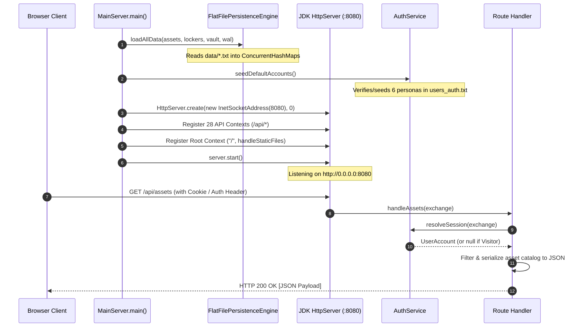
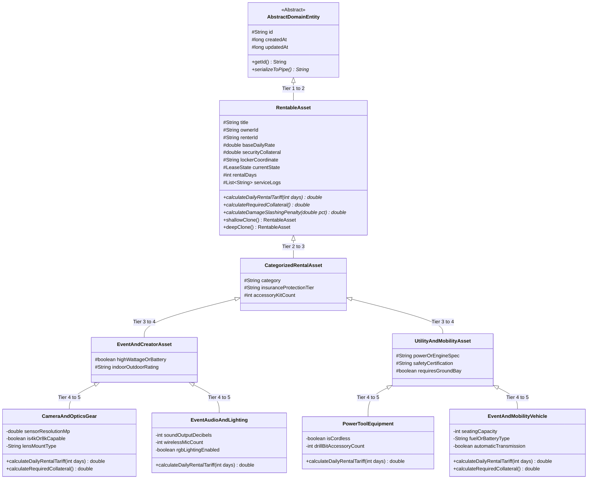
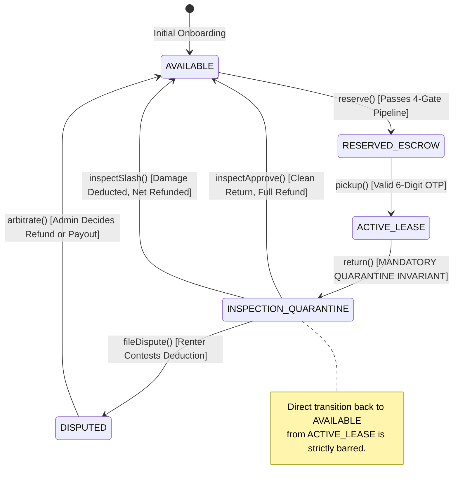

# RentSphere: Comprehensive Project Architecture Specification

**Project Title**: RentSphere: Peer-to-Peer (P2P) Equipment Rental Marketplace & 8×8 Smart Pickup Hub  
**Institution**: Department of Computer Science & Technology, Goa University  
**Degree Program**: Master of Computer Applications (MCA) — Object-Oriented Technology (OOT) Lab Mini-Project  
**Document Classification**: Architectural Master Reference & Implementation Blueprint  
**Runtime Platform**: Java SE 17+ / 25 (Standard APIs Only, Zero External JARs)  
**Currency Standard**: Indian Rupees (`₹` INR)  
**Storage Architecture**: Deterministic Zero-Database Flat Files (`data/*.txt`) with Atomic Move Staging & WAL  

---

## 1. High-Level System Architecture

RentSphere is a pure Object-Oriented full-stack web application designed for community equipment sharing with an integrated 64-bay (8×8 matrix) physical smart pickup and ground mobility hub.

```mermaid
graph TD
    subgraph ClientLayer ["Client Presentation Layer (Browser)"]
        UI["Responsive HTML5 / CSS3 / Vanilla JS Frontend"]
        Tab1["Marketplace & Search"]
        Tab2["8x8 Smart Hub (A1-H8)"]
        Tab3["Escrow & Quarantine"]
        Tab4["Host Studio & Diagnostics"]
        Tab5["Admin & Grievance Hub"]
        Modals["Auth / Checkout / Dispute / Policy Modals"]
    end

    subgraph ApiLayer ["Server & API Dispatcher (MainServer.java : 8080)"]
        HttpSvr["JDK HttpServer (com.sun.net.httpserver)"]
        Router["Path & Method Route Dispatcher"]
        StaticSvr["Static Web File Handler (frontend/)"]
        SecurityFilter["Session & RBAC Middleware"]
    end

    subgraph CoreServices ["Application & Domain Services"]
        AuthSvc["AuthService (PBKDF2-HMAC-SHA256)"]
        PaySvc["SandboxPaymentAdapter (HMAC-SHA256)"]
        PipeSvc["4-Gate FailFastPipeline"]
        LockerSvc["SmartLockerGrid8x8 & SimulatedLockerDevice"]
        DisputeSvc["DisputeService"]
        SupportSvc["SupportService (IT Rules 2021)"]
        NotifSvc["NotificationService"]
        PolicySvc["PolicyService (20 Indian Policies)"]
        MetaSvc["ReflectionInspector & PrototypeCloner"]
        TrustSvc["TrustScoreEngine"]
    end

    subgraph DomainModels ["5-Tier Domain & State Engine"]
        Entity["Tier 1: AbstractDomainEntity"]
        Rentable["Tier 2: RentableAsset (Cloneable)"]
        Categorized["Tier 3: CategorizedRentalAsset"]
        EventUtility["Tier 4: EventAndCreatorAsset / UtilityAndMobilityAsset"]
        Leaves["Tier 5: Camera / Audio / Tool / Vehicle"]
        StateEngine["GoF LeaseState (Available, Reserved, Active, Quarantine, Disputed)"]
        EscrowEngine["EscrowVault & EscrowAccount (Double-Entry)"]
    end

    subgraph PersistenceLayer ["Deterministic Zero-DB Flat-File Storage (data/)"]
        Engine["FlatFilePersistenceEngine (Atomic .tmp Staging)"]
        F_Assets[("assets_ledger.txt")]
        F_Lockers[("locker_grid_8x8.txt")]
        F_Vault[("escrow_vault.txt")]
        F_Users[("users_auth.txt")]
        F_Payments[("payments_ledger.txt")]
        F_Disputes[("disputes_ledger.txt")]
        F_Policies[("policy_acceptance.txt")]
        F_Tickets[("support_tickets.txt")]
        F_Notifs[("notifications_log.txt")]
        F_Wal[("audit_wal.txt (Append-Only)")]
    end

    UI --> Modals
    UI --> Tab1 & Tab2 & Tab3 & Tab4 & Tab5
    UI -->|REST JSON / HTTP 8080| HttpSvr
    HttpSvr --> StaticSvr
    HttpSvr --> Router
    Router --> SecurityFilter
    SecurityFilter --> AuthSvc
    Router --> PaySvc & PipeSvc & LockerSvc & DisputeSvc & SupportSvc & NotifSvc & PolicySvc & MetaSvc & TrustSvc
    PipeSvc --> StateEngine
    StateEngine --> Leaves
    Leaves --> EventUtility --> Categorized --> Rentable --> Entity
    PaySvc --> EscrowEngine
    DisputeSvc --> EscrowEngine

    AuthSvc --> Engine
    LockerSvc --> Engine
    DisputeSvc --> Engine
    SupportSvc --> Engine
    NotifSvc --> Engine
    PolicySvc --> Engine
    Engine --> F_Assets & F_Lockers & F_Vault & F_Users & F_Payments & F_Disputes & F_Policies & F_Tickets & F_Notifs & F_Wal
```



---

## 2. File & Directory Responsibilities

The codebase adheres strictly to separation of concerns across 10 functional packages, standard root directories, and static assets:

| Directory / Package | Responsibility | Primary Files |
| :--- | :--- | :--- |
| `backend/src/rentsphere/api/` | Embedded HTTP server, route registration, JSON parsing, serialization, and HTTP utilities | `MainServer.java` |
| `backend/src/rentsphere/auth/` | Cryptographic password hashing, user entities, session tokens, and role-based access control | `AuthService.java`, `PasswordHasher.java`, `UserAccount.java`, `UserSession.java` |
| `backend/src/rentsphere/dispute/` | Post-return damage contestation, counter-evidence logging, and administrative arbitration | `DisputeRecord.java`, `DisputeService.java` |
| `backend/src/rentsphere/escrow/` | Double-entry wallet balances, escrow locking, tariff payouts, and collateral slashing in ₹ INR | `EscrowAccount.java`, `EscrowTransaction.java`, `EscrowVault.java` |
| `backend/src/rentsphere/locker/` | 64-bay physical matrix (A1–H8), spatial rules, hardware simulation, and Swing desktop GUI | `CompartmentSize.java`, `LockerCompartment.java`, `LockerDevice.java`, `SimulatedLockerDevice.java`, `SmartLockerGrid8x8.java`, `SwingLockerConsole.java` |
| `backend/src/rentsphere/meta/` | Generic repository, runtime RTTI reflection, Prototype deep cloning proof, and trust scoring | `GenericRepository.java`, `PrototypeCloner.java`, `ReflectionInspector.java`, `TrustScoreEngine.java` |
| `backend/src/rentsphere/model/` | 5-Tier Object-Oriented inheritance hierarchy with polymorphic tariff and deposit formulas | `AbstractDomainEntity.java`, `RentableAsset.java`, `CategorizedRentalAsset.java`, `EventAndCreatorAsset.java`, `UtilityAndMobilityAsset.java`, `CameraAndOpticsGear.java`, `EventAudioAndLighting.java`, `PowerToolEquipment.java`, `EventAndMobilityVehicle.java` |
| `backend/src/rentsphere/payment/` | Payment gateway interface, order model, and Indian sandbox adapter with HMAC-SHA256 | `PaymentGateway.java`, `PaymentOrder.java`, `SandboxPaymentAdapter.java` |
| `backend/src/rentsphere/persistence/` | Thread-safe flat-file persistence engine with atomic `.tmp` staging and append-only WAL | `FlatFilePersistenceEngine.java` |
| `backend/src/rentsphere/pipeline/` | 4-Gate fail-fast validation pipeline short-circuiting on invariant violations | `VerificationGate.java`, `GateResult.java`, `PipelineContext.java`, `KycIdentityGate.java`, `StateLegalityGate.java`, `EscrowSolvencyGate.java`, `LockerSpatialGate.java`, `FailFastPipeline.java` |
| `backend/src/rentsphere/policy/` | 20 Indian statutory policy documents, versioned consent logging (DPDP Act 2023) | `PolicyService.java` |
| `backend/src/rentsphere/state/` | GoF State Pattern implementations managing the complete asset rental lifecycle | `LeaseState.java`, `AvailableState.java`, `ReservedEscrowState.java`, `ActiveLeaseState.java`, `InspectionQuarantineState.java`, `DisputedState.java` |
| `backend/src/rentsphere/support/` | In-app notification queue and statutory Grievance Redressal ticketing (IT Rules 2021) | `NotificationService.java`, `SupportService.java` |
| `frontend/` | **Authoritative Web UI**: HTML5 structure, responsive Warm Horizon CSS, client app logic | `index.html`, `css/styles.css`, `js/app.js` |
| `src/main/resources/static/` | Secondary Maven static resources mirror (kept synchronized for Maven builds) | `index.html`, `css/styles.css`, `js/app.js` |
| `data/` | Human-readable pipe-delimited persistence store (zero external database) | 9 flat files (`*.txt`) |
| `tests/` | Comprehensive automated test suite exercising all 16 operational domains | `RentSphereVerificationTest.java` |
| `polyglot/` | Educational polyglot mirrors matching MCA curriculum requirements | `cpp/rentsphere_core.cpp`, `csharp/RentSphereCore.cs`, `python/rentsphere_core.py` |

---

## 3. Application Startup & Request Lifecycle



---

## 4. Complete Rental Lifecycle Sequence

The platform executes a 6-phase lifecycle enforcing fail-fast gate validation, atomic escrow locking, 6-digit OTP compartment unlocking, mandatory return quarantine, and administrative dispute arbitration:

```mermaid
sequenceDiagram
    autonumber
    actor Renter as Verified Renter
    actor Host as Equipment Host
    actor Admin as Grievance / Hub Admin
    participant Server as MainServer (:8080)
    participant Pipeline as FailFastPipeline
    participant State as LeaseState (GoF)
    participant Escrow as EscrowVault
    participant Locker as SmartLockerGrid8x8

    Note over Renter,Server: PHASE 1: DISCOVERY & 4-GATE RESERVATION
    Renter->>Server: POST /api/assets/reserve {assetId, renterId, days}
    Server->>Pipeline: execute(PipelineContext)
    Pipeline->>Pipeline: Gate 1: KycIdentityGate (anti-self-rental)
    Pipeline->>Pipeline: Gate 2: StateLegalityGate (must be AVAILABLE)
    Pipeline->>Pipeline: Gate 3: EscrowSolvencyGate (balance >= tariff*days + deposit)
    Pipeline->>Pipeline: Gate 4: LockerSpatialGate (compartment compatible)
    Pipeline-->>Server: GateResult.success()
    Server->>Escrow: lockFunds(renterId, totalDue, assetId)
    Server->>State: asset.setState(new ReservedEscrowState())
    Server->>Locker: generateSecureOtp(bayId)
    Server-->>Renter: HTTP 200 {status: "RESERVED", otpPin: "******"}

    Note over Renter,Server: PHASE 2: HUB PHYSICAL PICKUP
    Renter->>Server: POST /api/assets/pickup {assetId, renterId, otpPin}
    Server->>Locker: verifyOtpAndUnlock(bayId, otpPin)
    Note over Locker: 3-strike lockout & 60-min expiry check
    Server->>State: asset.setState(new ActiveLeaseState())
    Server-->>Renter: HTTP 200 {status: "ACTIVE_LEASE", door: "UNLOCKED"}

    Note over Renter,Server: PHASE 3: RETURN & MANDATORY QUARANTINE
    Renter->>Server: POST /api/assets/return {assetId, renterId}
    Server->>State: asset.setState(new InspectionQuarantineState())
    Note over State: Invariant: Assets CANNOT return directly to Available
    Server-->>Renter: HTTP 200 {status: "INSPECTION_QUARANTINE"}

    Note over Host,Server: PHASE 4A: CLEAN INSPECTION APPROVAL
    Host->>Server: POST /api/assets/inspect-approve {assetId}
    Server->>Escrow: releaseCleanReturn(renterId, hostId, tariff*days, deposit)
    Note over Escrow: Tariff paid to host; deposit 100% refunded to renter
    Server->>State: asset.setState(new AvailableState())
    Server-->>Host: HTTP 200 {status: "AVAILABLE", depositRefunded: true}

    Note over Host,Admin: PHASE 4B: DAMAGE CONTESTATION & ARBITRATION
    Host->>Server: POST /api/assets/inspect-slash {assetId, damagePct, notes}
    Renter->>Server: POST /api/disputes/file {assetId, claimNotes, photoUrls}
    Server->>State: asset.setState(new DisputedState())
    Admin->>Server: POST /api/disputes/resolve {disputeId, resolution, penaltyAmt}
    Server->>Escrow: executeArbitration(renterId, hostId, penaltyAmt, deposit)
    Server->>State: asset.setState(new AvailableState())
    Server-->>Admin: HTTP 200 {status: "RESOLVED", assetState: "AVAILABLE"}
```

---

## 5. Object-Oriented Design & Design Pattern Realization

RentSphere is explicitly architected around proven Object-Oriented software design patterns:

### 5.1 5-Tier Inheritance Hierarchy (`rentsphere.model.*`)



### 5.2 GoF Behavioral State Pattern (`rentsphere.state.*`)



### 5.3 4-Gate Fail-Fast Verification Pipeline (`rentsphere.pipeline.*`)

The pipeline implements the Strategy and Chain-of-Responsibility patterns. When an incoming rental request is processed, each gate evaluates a critical invariant and aborts immediately upon violation:

1. **Gate 1 (`KycIdentityGate`)**: Verifies renter exists, KYC is active, account is not suspended, and enforces the anti-self-rental rule (`renterId != asset.ownerId`).
2. **Gate 2 (`StateLegalityGate`)**: Verifies asset is strictly in `AvailableState` (`currentState.canReserve() == true`).
3. **Gate 3 (`EscrowSolvencyGate`)**: Verifies renter wallet balance covers the total multi-day rental tariff plus refundable security collateral.
4. **Gate 4 (`LockerSpatialGate`)**: Verifies assigned physical locker bay is vacant, size tier is sufficient, and enforces the **Row H Ground Bay rule** for mobility assets.

### 5.4 Prototype Pattern Deep vs. Shallow Cloning (`rentsphere.meta.PrototypeCloner`)

The listing cloner demonstrates precise memory reference mechanics:
- **Shallow Cloning (`clone()`)**: Copies primitive fields, but shares internal reference collections (`serviceLogs`). Modifying the clone mutates the original asset's service history (`System.identityHashCode(original.logs) == System.identityHashCode(clone.logs)`).
- **Deep Cloning (`deepClone()`)**: Explicitly allocates a new `ArrayList<String>(serviceLogs)`, ensuring total heap isolation (`System.identityHashCode(original.logs) != System.identityHashCode(clone.logs)`).

### 5.5 Runtime RTTI Reflection (`rentsphere.meta.ReflectionInspector`)

Uses `java.lang.reflect` to introspect arbitrary domain entities at runtime:
- Recursively walks class inheritance chains from Tier 5 up to `Object.class`.
- Inspects declared fields, access modifiers (`private`, `protected`), and data types.
- Extracts declared methods, return types, and parameter counts.
- Powers the Host Diagnostics workbench without external reflection libraries.

---

## 6. Authentication & Authorization Architecture

### 6.1 Cryptographic Password Hashing (`PasswordHasher.java`)
- **Algorithm**: `PBKDF2WithHmacSHA256`
- **Salt**: 32 cryptographically random bytes generated via `SecureRandom`
- **Work Factor**: 100,000 iterations
- **Key Length**: 256 bits (32 bytes)
- **Comparison**: Constant-time `MessageDigest.isEqual()` to prevent timing attacks.

### 6.2 Session Management (`UserSession.java` & `AuthService.java`)
- **Token Generation**: 32-byte cryptographically random hex token (64 hex characters)
- **Lifetime**: 24 hours (`86,400,000 ms`)
- **Transport**: Accepted via HTTP `Authorization: Bearer <token>` or `Cookie: rs_session=<token>`
- **Resolution**: Cached in thread-safe `ConcurrentHashMap<String, UserSession>` and resolved on every request.

### 6.3 Server-Side Role-Based Access Control (RBAC)
The application enforces strict vertical and horizontal authorization:
- `VISITOR`: Read-only access to `/api/health`, `/api/assets`, `/api/lockers` (with OTP masked as `""`), and `/api/policies`.
- `RENTER`: May reserve available assets, authorize payments, unlock assigned lockers using valid OTP, initiate returns, and file disputes on held collateral.
- `HOST`: May onboard new equipment, clone listings, review inspection quarantine queues, approve clean returns, and slash collateral on verified damage.
- `ADMIN`: Unrestricted platform supervision, dispute arbitration, user account suspension/reinstatement, hub solenoid override, and grievance ticket resolution.

---

## 7. Zero-Database Flat-File Persistence Engine

RentSphere completely eliminates heavyweight SQL databases and ORMs in favor of high-performance, deterministic flat files:

```mermaid
graph LR
    subgraph Memory ["In-Memory Concurrent State"]
        MemAssets["ConcurrentHashMap<String, RentableAsset>"]
        MemLockers["ConcurrentHashMap<String, LockerCompartment>"]
        MemVault["ConcurrentHashMap<String, EscrowAccount>"]
        MemUsers["ConcurrentHashMap<String, UserAccount>"]
        MemDisputes["ConcurrentHashMap<String, DisputeRecord>"]
    end

    subgraph AtomicStage ["Atomic Write Staging"]
        TmpFile["TargetFile.tmp (Write & Flush)"]
        AtomicMove["Files.move(ATOMIC_MOVE, REPLACE_EXISTING)"]
    end

    subgraph Disk ["Flat Files (data/*.txt)"]
        DiskFile["Master Flat File (Deterministic Pipe Delimited)"]
        WalFile["audit_wal.txt (Append-Only Write-Ahead Log)"]
    end

    MemAssets & MemLockers & MemVault & MemUsers & MemDisputes -->|serializeToPipe()| TmpFile
    TmpFile -->|Atomic Replace| AtomicMove
    AtomicMove --> DiskFile
    MemAssets & MemVault -->|Critical Financial Event| WalFile
```

### 7.1 Atomic Write Staging (`writeLinesAtomically`)
To prevent data corruption if the JVM or host OS crashes during a write, `FlatFilePersistenceEngine` writes new content to a temporary staging file (`TargetFile.tmp`), flushes buffers to disk, and atomically replaces the destination file using `Files.move(..., StandardCopyOption.ATOMIC_MOVE, StandardCopyOption.REPLACE_EXISTING)`.

### 7.2 Append-Only Write-Ahead Log (`data/audit_wal.txt`)
All financial state transitions, escrow locks, payouts, collateral slashing, and arbitration rulings are appended immediately to the Write-Ahead Log before returning success to the client:
```text
TIMESTAMP_UTC|TRANSACTION_ID|ACTION|USER_ID|AMOUNT_INR|STATUS|METADATA
```

---

## 8. Complete API Reference

All endpoints listen on `http://localhost:8080` and consume/produce `application/json; charset=UTF-8`:

### 8.1 System & Telemetry Endpoints
- `GET /api/health`: Returns node status, active leases, quarantine count, total escrow capital, and Java runtime version.
- `OPTIONS /*`: Automatic CORS preflight handler responding with HTTP 204 No Content.

### 8.2 Authentication & User Endpoints
- `POST /api/auth/register`: Creates new user account with PBKDF2 hash; rejects duplicate emails.
- `POST /api/auth/login`: Authenticates email/userId and password; issues 256-bit session token and sets `rs_session` cookie.
- `POST /api/auth/logout`: Invalidates active session token.
- `GET /api/auth/me`: Returns currently authenticated user profile, role, and KYC status.

### 8.3 Asset & Marketplace Endpoints
- `GET /api/assets`: Returns complete equipment catalog with current GoF state, tariff, deposit, and hub bay coordinates.
- `POST /api/assets/onboard`: [HOST/ADMIN] Registers new asset in 8×8 grid; validates non-negative rates, occupancy, and Row H ground slot rule.
- `POST /api/assets/clone`: [HOST/ADMIN] Clones existing listing using Prototype Pattern Deep Cloning; assigns vacant locker bay.
- `POST /api/assets/reserve`: [RENTER] Executes 4-Gate Pipeline; locks multi-day tariff + deposit in escrow; generates 6-digit OTP.
- `POST /api/assets/pickup`: [RENTER/ADMIN] Verifies 6-digit OTP; triggers solenoid unlock; transitions asset to `ACTIVE_LEASE`.
- `POST /api/assets/return`: [RENTER/ADMIN] Returns gear to locker; enforces **Mandatory Quarantine Invariant** (`INSPECTION_QUARANTINE`).
- `POST /api/assets/inspect-approve`: [HOST/ADMIN] Approves clean return; pays host multi-day tariff; fully refunds deposit to renter.
- `POST /api/assets/inspect-slash`: [HOST/ADMIN] Deducts damage penalty from deposit; remits damages to host; refunds remaining balance to renter.

### 8.4 Smart Locker & Physical Hub Endpoints
- `GET /api/lockers`: Returns 64-bay status grid. **OTPs are masked as `""` for visitors and unauthorized callers (CWE-200 fix)**.
- `POST /api/lockers/verify-otp`: Verifies OTP PIN; enforces 3-strike brute-force lockout and 60-minute expiry (CWE-307 fix).
- `POST /api/admin/device/state`: [ADMIN ONLY] Solenoid hardware override (`ONLINE_READY`, `DOOR_UNLOCKED`, `MAINTENANCE_MODE`).

### 8.5 Payment Sandbox & Escrow Endpoints
- `POST /api/payments/create-order`: Generates Indian payment order with order ID in ₹ INR.
- `POST /api/payments/verify`: Verifies HMAC-SHA256 signature; transitions order to `CAPTURED`.
- `POST /api/payments/webhook`: Idempotent payment webhook processor; prevents duplicate payment credits.

### 8.6 Damage Disputes & Administrative Arbitration
- `GET /api/disputes`: Returns disputes. Requires authentication; regular users receive user-scoped records; admins receive all platform disputes.
- `POST /api/disputes/file`: [RENTER] Contests damage deduction; freezes asset in `DISPUTED` state; attaches evidence notes.
- `POST /api/disputes/resolve`: [ADMIN ONLY] Arbitrates dispute; releases frozen collateral according to binding ruling.

### 8.7 Statutory Grievance Redressal & Support
- `GET /api/support/tickets`: Returns support tickets. Requires authentication; regular users receive user-scoped tickets; admins receive all tickets.
- `POST /api/support/ticket`: Creates new grievance ticket; starts Rule 3(2) IT Rules 2021 statutory SLA clock.
- `POST /api/support/reply`: [ADMIN ONLY] Resolves ticket; records acting administrator ID and resolution timestamp.

### 8.8 Regulatory Policies & Notification Center
- `GET /api/policies`: Returns metadata for all 20 Indian regulatory policy documents.
- `GET /api/policies/detail?id={id}`: Returns full legal policy text.
- `POST /api/policies/accept`: Deterministically logs user consent with timestamp and IP address to `data/policy_acceptance.txt`.
- `GET /api/notifications`: Returns user notification queue and unread count.
- `POST /api/notifications/read-all`: Marks all notifications as read.

---

## 9. Frontend Architecture & Authoritative Directory

### 9.1 Directory Roles
- **Authoritative Directory (`frontend/`)**: This is the primary, live directory served directly by `MainServer.java` (`Paths.get("frontend")`). Any changes to HTML structure, styles, or client JavaScript must be made here.
- **Secondary Mirror (`src/main/resources/static/`)**: Static resource mirror retained for standard Maven packaging compatibility (`mvn clean package`). It is kept synchronized with `frontend/`.

### 9.2 Design System & Responsive Tokens
- **Theme**: "Warm Horizon Marketplace"
- **Color Palette**:
  - Primary Brand Teal: `#0D9488` (Tailored Teal), `#0A5C4D` (Deep Teal)
  - Warm Amber: `#F59E0B` (Tariff badges, warnings)
  - Emerald Green: `#10B981` (Available states, confirmed payments)
  - Quarantine Crimson: `#EF4444` (Inspection quarantine alerts, dispute tags)
  - Slate: `#64748B` (Secondary typography, borders)
- **Responsive Breakpoints**:
  - Desktop: `1440px` and `1024px`
  - Tablet: `768px` (2-column grid, horizontal scroll table)
  - Mobile: `480px` and `360px` (single-column cards, full-width touch-friendly modals)

---

## 10. Architectural Trade-Offs & Known Limitations

1. **Flat-File Multi-Document Transactions**: While individual files use atomic `.tmp` staging, multi-file updates (e.g., updating both `assets_ledger.txt` and `escrow_vault.txt`) lack two-phase distributed commit. Consistency is maintained through thread-safe synchronization and append-only auditing in `audit_wal.txt`.
2. **Payment Gateway Sandbox**: Simulates the authentic Razorpay / Cashfree order, signature, and webhook lifecycle with HMAC-SHA256, but runs against local test accounts rather than live banking rails.
3. **Smart Hub Hardware Simulation**: The 64-bay locker grid executes realistic sensor telemetry (temperature, humidity, load cell weight) and solenoid door states (`ONLINE_READY`, `DOOR_UNLOCKED`), but communicates through in-process interfaces (`SimulatedLockerDevice`) rather than physical MQTT or RS485 microcontroller buses.
