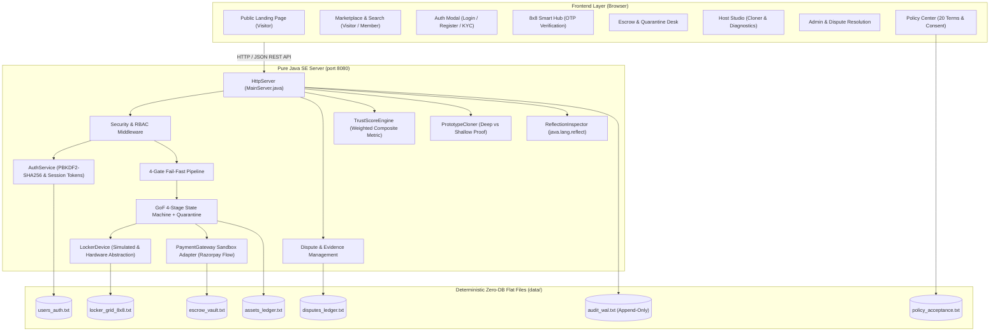

# RentSphere: Comprehensive Product, Security & Architectural Audit
**Platform**: RentSphere Peer-to-Peer (P2P) Rental Marketplace & 8x8 Smart Pickup Hub  
**Author**: Senior Full-Stack Software Architect, Application Security Engineer & QA Lead  
**Audit Date**: October 2026  
**Target Environment**: Controlled Campus / Local Community Pilot (Goa University & North Goa, India)  
**Currency Standard**: Indian Rupees (₹ INR)  

---

## 1. Executive Summary

RentSphere is an object-oriented full-stack web application designed for P2P equipment rentals with an integrated 64-bay (8×8) physical micro-storage grid engine. Built using Pure Java SE (JDK 17+/25) with zero external JAR dependencies, standard Java concurrency, reflection APIs, and deterministic flat-file persistence in `data/*.txt`.

While the application features clean implementations of core Object-Oriented Technology (OOT) design patterns (5-Tier Inheritance, 4-Stage GoF State Pattern, Prototype Pattern Deep Cloning, Meta-OOP Reflection, and a 4-Gate Fail-Fast Verification Pipeline), **it currently operates with critical security gaps, simulated authentication, and missing marketplace workflows**:

1. **Authentication & Authorization**: Currently implemented as a frontend `<select>` persona switch (`renter_deepak`, `host_faaris`, etc.) with zero server-side password hashing, no session tokens, no cookies, and no horizontal/vertical access control enforcement.
2. **OTP Security Flaw (CWE-200)**: The 6-digit pickup OTP is serialized in plain text on the public `GET /api/lockers` endpoint, allowing any unauthenticated network observer to read OTPs and unlock compartments.
3. **Absence of Real Financial Gateway Integration**: Escrow deposits and rental fees are modeled purely through in-memory ledger numbers without payment gateway order verification, webhooks, or idempotency keys.
4. **Missing Visitor / Public Landing Journey**: Unauthenticated visitors are dropped directly into the internal member dashboard rather than a consumer marketplace landing page.
5. **No Dispute Resolution or Return Evidence**: Renters cannot dispute damage claims, submit counter-evidence, or request admin arbitration.
6. **No Legal or Regulatory Compliance Center**: Essential Indian statutory policies (DPDP Act, Consumer Protection E-Commerce Rules, IT Act 2000, Grievance Redressal) are absent.

---

## 2. Architecture Diagram

---

## 3. Comprehensive Feature-by-Feature Classification

| Feature / Subsystem | Current Classification | Technical Assessment & Target State |
| :--- | :--- | :--- |
| **5-Tier Domain Model** (`CameraAndOpticsGear`, `EventAudioAndLighting`, `PowerToolEquipment`, `EventAndMobilityVehicle`) | **1. Implemented & Verified** | 42/42 tests passing. Polymorphic tariff and collateral surcharge formulas verified. Preserve 100%. |
| **GoF State Pattern** (`AvailableState`, `ReservedEscrowState`, `ActiveLeaseState`, `InspectionQuarantineState`) | **1. Implemented & Verified** | Mandatory Quarantine Invariant verified. Expand with `DISPUTED` and cancellation states. |
| **4-Gate Fail-Fast Pipeline** (KYC, Legality, Solvency, Spatial) | **1. Implemented & Verified** | All 4 gates unit-tested with short-circuiting. Bind directly to server-side authenticated sessions. |
| **8x8 Locker Matrix & Spatial Rules** (Row H Ground Slots H1–H8) | **1. Implemented & Verified** | 64 bays verified. Vehicle spatial invariant enforced. |
| **Prototype Deep vs Shallow Cloner** | **1. Implemented & Verified** | Proved memory reference isolation using `System.identityHashCode()`. |
| **Meta-OOP Live Reflection** (`java.lang.reflect`) | **1. Implemented & Verified** | Dynamic hierarchy and field inspection operational. |
| **RentSphere Trust Score Calculator** | **1. Implemented & Verified** | Weighted composite scoring (30/30/20/10/10) with What-If deep cloning simulation. |
| **Flat-File Persistence & WAL** | **2. Implemented, Insufficiently Tested** | Direct unbuffered file overwriting lacks atomic rename/replace. Vulnerable to corruption on sudden process kill. |
| **Authentication & Session Security** | **4. UI Simulation Only** | Persona dropdown switch in header. No passwords, no hashing, no sessions. Must build PBKDF2-SHA256 password hashing and cryptographically secure session manager. |
| **Authorization & Server-Side RBAC** | **5. Missing** | Any user can trigger any host or admin action. Need strict role checks (Visitor, Renter, Host, Admin). |
| **OTP Security & Lockout Protection** | **3. Partially Implemented (Vulnerable)** | OTP generated via `SecureRandom` but leaked in `/api/lockers`. No attempt counter, lockout, or expiry. |
| **Public Visitor Landing Journey** | **4. UI Simulation Only** | Non-authenticated users immediately see internal app. Need public homepage explaining how it works, pricing, FAQs. |
| **Payment Gateway Integration** | **4. UI Simulation Only** | Wallet debit simulation only. Must build Indian Payment Gateway Sandbox Adapter (Razorpay/Cashfree order flow, signatures, webhooks). |
| **Dispute Resolution & Evidence** | **5. Missing** | Renters cannot contest damage deductions. Need dispute states, counter-evidence submission, admin arbitration. |
| **Inspection Timeout / Deadlines** | **5. Missing** | Quarantine holds indefinite until host manual action. Need automated deadline escalation and policy resolution. |
| **Legal Policy Center** | **5. Missing** | No Terms of Service, Privacy Policy under DPDP Act, Rental Agreement, or Consent logging. |
| **Admin & Support Dashboard** | **3. Partially Implemented** | Only Inspector profile exists. Need dedicated Admin console for disputes, user management, and audit log inspection. |
| **In-App Notifications & Support** | **5. Missing** | No user notification center or support ticket submission. |
| **Device Hardware Abstraction** | **5. Missing** | Logic embedded in compartment model. Need `LockerDevice` interface and `SimulatedLockerDevice`. |
| **Physical Lock Solenoids / Real IoT** | **6. Blocked by External Hardware** | Hardware sensors and microcontrollers (ESP32/MQTT/GPIO) not physically connected in this workstation; cleanly handled via simulated device adapter. |

---

## 4. Security Threat & Vulnerability Audit (OWASP / CWE)

1. **CWE-200 / CWE-359: Sensitive Data Exposure (Critical)**
   - *Vulnerability*: `MainServer.java` serializes `comp.getOtpPin()` in `/api/lockers`.
   - *Remediation*: Strip `otpPin` completely from public locker listings. Only return OTP to the authenticated renter holding the reservation or in the protected admin diagnostic console.
2. **CWE-306: Missing Authentication for Critical Function (Critical)**
   - *Vulnerability*: `/api/assets/reserve`, `/api/assets/pickup`, `/api/assets/return`, `/api/assets/inspect-approve`, and `/api/assets/inspect-slash` accept unauthenticated JSON payloads.
   - *Remediation*: Implement `SessionManager` verifying cryptographically secure session tokens from HTTP-only cookies or Authorization headers. Enforce `renterId == session.userId` or `ownerId == session.userId`.
3. **CWE-287 / CWE-256: Plaintext Identity / Unprotected Credentials (High)**
   - *Vulnerability*: Users exist without passwords.
   - *Remediation*: Implement standard PBKDF2-With-HmacSHA256 password hashing with 32-byte cryptographically random salt and 100,000 iterations.
4. **CWE-307: Improper Restriction of Excessive Authentication Attempts (High)**
   - *Vulnerability*: `/api/lockers/verify-otp` has no rate-limiting or lockout, allowing 6-digit OTP brute-forcing in minutes.
   - *Remediation*: Enforce maximum 3 failed attempts before a 15-minute bay lockout, plus a 60-minute OTP expiration timestamp.
5. **CWE-362: Race Condition in File Persistence (Medium)**
   - *Vulnerability*: Direct write to production files without temporary file stage.
   - *Remediation*: Implement atomic writes: write to `.tmp` file, flush, sync, and atomically replace the target file via `Files.move(..., ATOMIC_MOVE)`.
6. **CWE-693: Missing Security Headers (Medium)**
   - *Vulnerability*: HTTP responses lack browser security headers.
   - *Remediation*: Inject `X-Content-Type-Options: nosniff`, `X-Frame-Options: DENY`, `X-XSS-Protection: 1; mode=block`, and `Referrer-Policy: strict-origin-when-cross-origin`.

---

## 5. Phased Implementation Roadmap & Acceptance Criteria

### Phase 2: Core Access, Authentication & Public Portal
- Implement `UserAccount` with email, PBKDF2-SHA256 password hash, salt, role (`VISITOR`, `RENTER`, `HOST`, `ADMIN`), and KYC status.
- Implement session manager generating 32-byte secure tokens with HTTP-only cookies.
- Create `/api/auth/register`, `/api/auth/login`, `/api/auth/logout`, `/api/auth/me`.
- Build public consumer landing page with hero, how-it-works, FAQs, legal links, and registration/login modals.
- Enforce server-side RBAC across all state mutation endpoints.

### Phase 3: Booking & Financial Lifecycle (Payments & Deposits Sandbox)
- Implement `PaymentGateway` interface and `SandboxPaymentAdapter` for Indian gateways (Razorpay order creation, payment ID generation, signature simulation, webhook handler).
- Explicitly separate rental tariffs from refundable security deposits in all ledger transactions.
- Implement booking cancellation and deposit refund workflows.

### Phase 4: Physical Rental Operations & Hub Security
- Redesign OTP lifecycle: cryptographically random 6-digit PIN, 60-minute expiry, 3-attempt lockout.
- Create `LockerDevice` interface and `SimulatedLockerDevice` with status tracking (`READY`, `OCCUPIED`, `JAMMED`, `OFFLINE`, `MAINTENANCE`).
- Implement Renter Return workflow with condition evidence logging.
- Implement Dispute Resolution Subsystem (`DisputeRecord`, `/api/disputes/file`, `/api/disputes/resolve`).

### Phase 5: Legal, Operational & Trust Features
- Author 20 comprehensive policy documents drafted for Indian jurisdiction (DPDP Act, Consumer Protection E-Commerce Rules, IT Act 2000).
- Implement versioned policy consent logging on registration and checkout.
- Build In-App Notification Center (`/api/notifications`) and Support Ticket system (`/api/support/tickets`).
- Build Administrator & Support Console (`/api/admin/*`) for account management, dispute review, and system audits.

### Phase 6: UI Quality, Responsive Design & Accessibility
- Polish responsive mobile design, hamburger navigation, touch-friendly 8×8 grid, and ARIA labels.
- Eliminate all placeholder links and dead buttons.

### Phase 7: Verification & Final Handover
- Expand test suite to cover Auth, RBAC, Payments, Disputes, OTP Lockout, Atomic I/O.
- Run complete test suite and browser subagent verification.
- Provide all final documentation deliverables.
