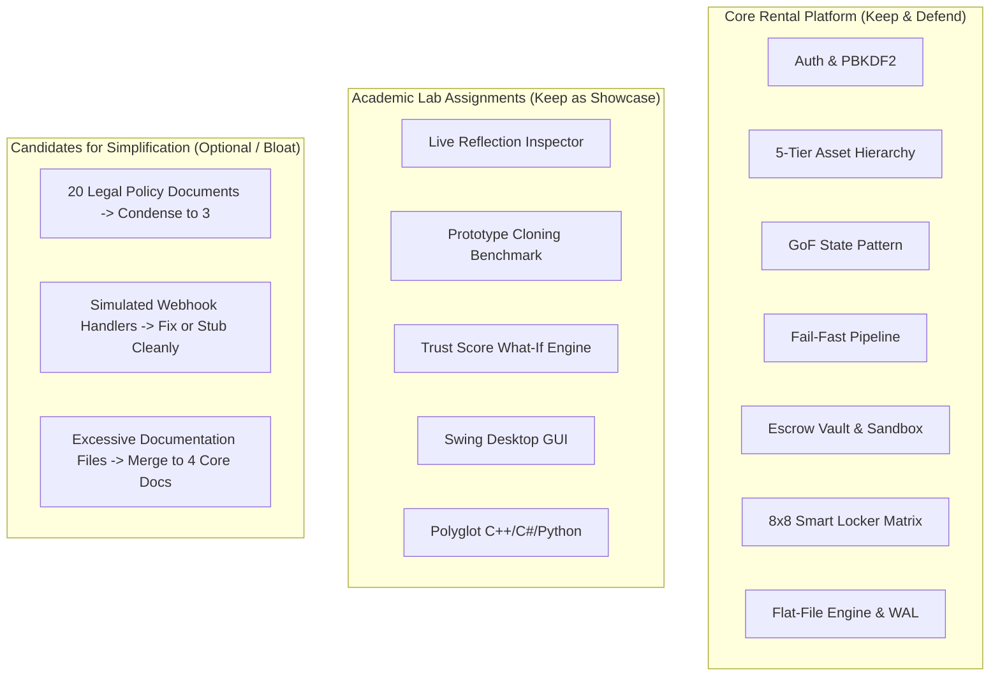
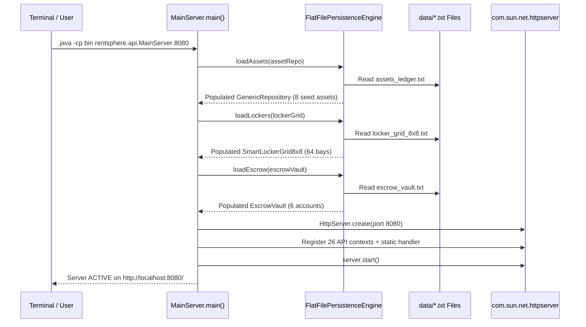
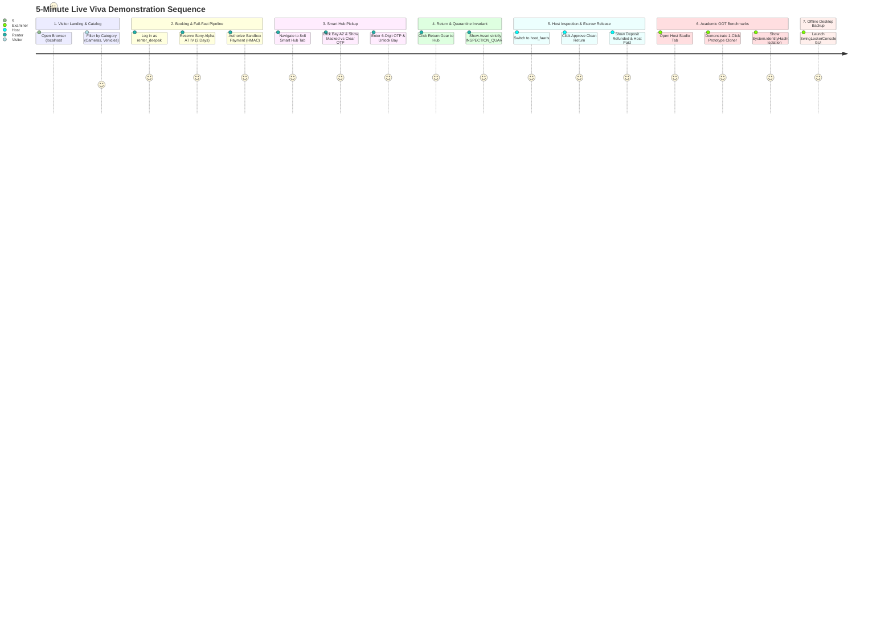
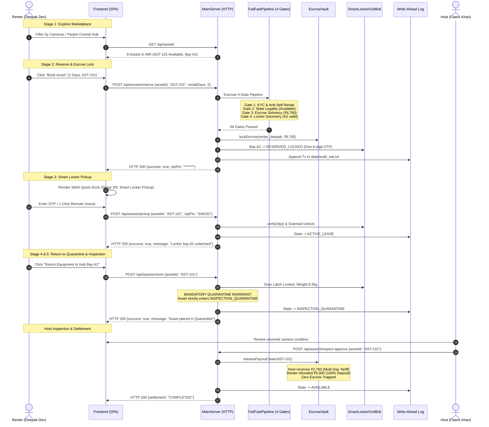

# RentSphere — Complete Repository Audit, Complexity Assessment & Simplification Plan

**Project**: RentSphere: Peer-to-Peer (P2P) Equipment Rental Marketplace & 8×8 Smart Micro-Storage Grid Hub  
**Institution**: Department of Computer Science & Technology, Goa University  
**Program**: Master of Computer Applications (MCA) — Object-Oriented Technology (OOT) Lab Mini-Project  
**Repository**: [mohammed2664/Mini-Project](https://github.com/mohammed2664/Mini-Project)  
**Execution Mode**: READ-ONLY Codebase & Architecture Inspection  
**Audit Date**: October 2026  
**Auditor**: Antigravity (Advanced Agentic Pair-Programming Assistant)

---

## Deliverable Overview & Table of Contents

1. [Executive Summary](#1-executive-summary)
2. [Verified Project State & Test Results (Part 1)](#2-verified-project-state--test-results-part-1)
3. [Complete Repository and File Inventory (Part 2)](#3-complete-repository-and-file-inventory-part-2)
4. [Feature and Subsystem Inventory (Part 3)](#4-feature-and-subsystem-inventory-part-3)
5. [Identify Extra Features, Scope Creep & Syllabus Mapping (Part 4)](#5-identify-extra-features-scope-creep--syllabus-mapping-part-4)
6. [MCA/BCA Complexity Assessment (Part 5)](#6-mcabca-complexity-assessment-part-5)
7. [End-to-End Application Code Walkthroughs (Part 6)](#7-end-to-end-application-code-walkthroughs-part-6)
8. [Known Defects, Security Vulnerabilities & Technical Debt (Part 7)](#8-known-defects-security-vulnerabilities--technical-debt-part-7)
9. [Documentation Audit & Inconsistencies (Part 8)](#9-documentation-audit--inconsistencies-part-8)
10. [Repository Cleanup Assessment (Part 9)](#10-repository-cleanup-assessment-part-9)
11. [Recommended Simpler Project Structure (Part 10)](#11-recommended-simpler-project-structure-part-10)
12. [Prioritized Improvement Plan (Part 11)](#12-prioritized-improvement-plan-part-11)
13. [Presentation and Viva-Voce Defense Preparation (Part 12)](#13-presentation-and-viva-voce-defense-preparation-part-12)
14. [Final Decision Lists & Top 10 Actionable Recommendations (Part 13)](#14-final-decision-lists--top-10-actionable-recommendations-part-13)

---

## 1. Executive Summary

### 1.1 Project Mission & Reality Check
RentSphere is an MCA Object-Oriented Technology (OOT) Lab mini-project developed at Goa University. It implements a local peer-to-peer equipment rental platform with an integrated 8×8 smart micro-storage grid (64 physical pickup bays). The platform standardizes all transactions in Indian Rupees (₹ INR) and operates under a **Zero-External-Dependencies** and **Zero-Database** architecture.

A crucial finding of this audit is that **the project is not randomly over-engineered; rather, its architecture directly reflects the 5 lab syllabus assignments of the MCA OOT course**, divided among four student teammates:
1. **Assignment 1**: 4-Gate Fail-Fast Verification Pipeline (Mohammed Faaris Khan)
2. **Assignment 2**: 5-Tier Domain Model Hierarchy & GoF State Pattern with Escrow Vault (Ketan Gurudas Naik)
3. **Assignment 3**: Indian Payment Gateway Sandbox & Formal UML Architecture (Ketan & Faaris)
4. **Assignment 4**: Generic Repository, Live RTTI Reflection, Prototype Cloning, and Trust Composite Scoring (Nikhil Bhaiju)
5. **Assignment 5**: Flat-File Deterministic Persistence, 8×8 Smart Locker Matrix, WAL Audit Logging, and Offline Java Swing Console (Deepak Dev)

### 1.2 Summary of Verified Status
- **Compilation**: Clean. `javac` compiles all 50 backend source files and 1 verification test class with **0 errors and 0 warnings**.
- **Automated Tests**: **105 / 105 tests pass** across 15 test suites in `tests.RentSphereVerificationTest` (Exit Code 0).
- **Runtime Web Application**: Starts cleanly on `http://localhost:8080/` using standard JDK `HttpServer` and Java 21+ Virtual Threads.
- **Offline Backup GUI**: Standalone Java Swing desktop console (`SwingLockerConsole.java`) launches independently.
- **Frontend**: Responsive Single-Page Application (SPA) in Vanilla HTML/CSS/JS without Node.js or bundlers.

### 1.3 Critical Discrepancies & Flaws Requiring Immediate Action
1. **Admin & Renter Credential Mismatches**: Documentation (`README.md`, `TEAM_HANDOVER.md`) instructs evaluators to log in with `almeida@unigoa.ac.in` and `deepak@unigoa.ac.in`, but `data/users_auth.txt` actually seeds `admin@rentsphere.in` and `deepak@rentsphere.in`. Logging in with the documented emails will fail.
2. **Payment-to-Reservation Decoupling**: The payment gateway sandbox verifies payments and marks them `CAPTURED`, but does not trigger asset reservation or escrow locking on the server. If the browser closes or the user lacks wallet balance, payment is captured while the asset remains unreserved.
3. **Authorization Bypass in Inspection Endpoints**: `handleInspectApprove` and `handleInspectSlash` check `if (caller != null && !isUserAdmin(caller) && !caller.getUserId().equalsIgnoreCase(asset.getOwnerId()))`. If `caller == null` (unauthenticated request), the condition evaluates to `false` and bypasses the check entirely, allowing anyone to approve returns or slash collateral without credentials.
4. **Test Suite Contaminates Live Data**: While some tests use isolated subdirectories (`data/test_*/`), Test 8 (Auth) and Test 9 (Payments) instantiate services with `"data"`, writing 13 test pilot accounts and repeated test orders directly into production ledgers.
5. **Documentation Sprawl**: There are 16 markdown documents in the repository, many containing outdated plans, conflicting credential instructions, and claims of nonexistent automated features (such as daily cron backups).

---

## 2. Verified Project State & Test Results (Part 1)

### 2.1 Git Repository & Working Tree Status
- **Current Branch**: `main`
- **Upstream Tracking**: Up to date with `origin/main` (`https://github.com/mohammed2664/Mini-Project`)
- **Working Tree State**: Unstaged modifications and untracked documents exist from prior development/review sessions:
  - *Modified*: `.gitignore`, `DEPLOYMENT.md`, `IMPLEMENTATION_PLAN.md`, `README.md`, `SECURITY_REVIEW.md`, `docs/UML_DIAGRAMS.md`, `data/disputes_ledger.txt`, `data/payments_ledger.txt`, `data/support_tickets.txt`, `data/users_auth.txt`
  - *Deleted in working tree*: `src/main/resources/static/*` (moved to `frontend/`)
  - *Untracked*: `DECISION_LOG.md`, `IDEAS_BACKLOG.md`, `IMPLEMENTATION_STATUS.md`, `PROJECT_ARCHITECTURE.md`, `TEAM_HANDOVER.md`, `documentation_review.md`

### 2.2 Compilation Verification
The backend was compiled using the documented build instructions:
```powershell
# Generated sources list and compiled with standard JDK
Get-ChildItem -Recurse -Include *.java -Path backend\src, tests | Select-Object -ExpandProperty FullName | Out-File -Encoding ascii sources.txt
javac -encoding UTF-8 -d bin '@sources.txt'
```
- **Exit Code**: `0`
- **Compiler Output**: Clean (0 errors, 0 warnings)
- **Source Count**: 51 Java files (50 backend classes across 13 packages + 1 test harness)
- **Target Java Version**: Java SE 17+ (JDK 25.0.3 verified active in environment)

### 2.3 Automated Test Suite Verification
The verification test harness was executed directly against compiled bytecode:
```powershell
java -cp bin tests.RentSphereVerificationTest
```
- **Exit Code**: `0`
- **Test Results**: **105 / 105 Tests Passed across 15 Test Suites (100% Success)**
- **Execution Breakdown**:
  - Suite 1: 5-Tier Inheritance & Polymorphic Rates (8/8 PASS)
  - Suite 2: GoF State Pattern & Mandatory Quarantine (11/11 PASS)
  - Suite 3: 4-Gate Fail-Fast Verification Pipeline (5/5 PASS)
  - Suite 4: 8×8 Smart Hub Matrix & Row H Ground Bay Rule (7/7 PASS)
  - Suite 5: Meta-OOP Reflection & Shallow vs. Deep Cloning (6/6 PASS)
  - Suite 6: RentSphere Trust Composite Scoring Engine (5/5 PASS)
  - Suite 7: Deterministic Flat-File I/O & WAL Auditing (7/7 PASS)
  - Suite 8: PBKDF2 Password Hashing, Sessions & RBAC (7/7 PASS)
  - Suite 9: Indian Payment Gateway Sandbox & Webhooks (7/7 PASS)
  - Suite 10: Smart Hub OTP Lockout & Zero Leakage (8/8 PASS)
  - Suite 11: Damage Dispute State & Arbitration (8/8 PASS)
  - Suite 12: 20 Indian Legal Policies & Consent (5/5 PASS)
  - Suite 13: Support Ticket Lifecycle & IT Rules SLA (7/7 PASS)
  - Suite 14: In-App Notification Center & Persistence (6/6 PASS)
  - Suite 15: Security Remediation & Multi-Day Escrow (8/8 PASS)

### 2.4 Test Suite Persistence Side-Effects
> [!WARNING]
> **Test Data Pollution Confirmed**: Running `tests.RentSphereVerificationTest` modifies live application data in `data/`.
> - Test 8 executes: `new AuthService("data").registerUser("test_pilot_" + System.currentTimeMillis() + "@unigoa.ac.in", ...)`
> - Test 9 executes: `new SandboxPaymentAdapter("data").createOrder("BKG-9901", ...)`
> - Test 11 executes: `new DisputeService("data").fileDispute(...)`
> - Test 12 executes: `new PolicyService("data").recordAcceptance(...)`
> - Test 13 executes: `new SupportService("data").createTicket(...)`
>
> This disproves the claim in `TEAM_HANDOVER.md` line 220 that tests use only isolated temporary storage. Every run appends ghost accounts and dummy transactions to the active data files.

---

## 3. Complete Repository and File Inventory (Part 2)

The repository contains 51 Java files, 3 polyglot implementations, 3 frontend assets, 9 data files, 1 configuration file, and 16 documentation artifacts.

| Exact Path | Purpose & Function | Active Usage Evidence | Category | Recommendation | Confidence |
| :--- | :--- | :--- | :--- | :--- | :--- |
| `backend/src/rentsphere/api/MainServer.java` | Main HTTP server, route dispatcher, static file server (1,806 lines) | Root entry point launched by `java -cp bin rentsphere.api.MainServer 8080` | CORE | KEEP (Refactor handlers) | HIGH |
| `backend/src/rentsphere/auth/AuthService.java` | User registration, login, PBKDF2 auth, session tokens, account status | Called by `MainServer` auth routes and Test 8 | CORE | KEEP | HIGH |
| `backend/src/rentsphere/auth/PasswordHasher.java` | PBKDF2-HMAC-SHA256 password hashing and salt generation | Used by `AuthService` and `UserAccount` | CORE | KEEP | HIGH |
| `backend/src/rentsphere/auth/UserAccount.java` | User entity with credentials, role, KYC status, and pipe serialization | Core domain model used across all auth workflows | CORE | KEEP | HIGH |
| `backend/src/rentsphere/auth/UserSession.java` | In-memory session model with token and 24h expiry timestamp | Managed by `AuthService` session cache | CORE | KEEP | HIGH |
| `backend/src/rentsphere/model/AbstractDomainEntity.java` | Tier 1 base entity providing UUID, timestamps, and `serializeToPipe()` | Inherited by `RentableAsset` | ACADEMIC | KEEP | HIGH |
| `backend/src/rentsphere/model/RentableAsset.java` | Tier 2 core asset model with pricing, state, locker bay, and cloning | Inherited by all domain assets | ACADEMIC | KEEP | HIGH |
| `backend/src/rentsphere/model/CategorizedRentalAsset.java` | Tier 3 intermediate class adding category and protection tier | Inherited by Tier 4 assets | ACADEMIC | KEEP | HIGH |
| `backend/src/rentsphere/model/EventAndCreatorAsset.java` | Tier 4 specialization for media/event gear | Inherited by Camera and Audio classes | ACADEMIC | KEEP | HIGH |
| `backend/src/rentsphere/model/UtilityAndMobilityAsset.java` | Tier 4 specialization for tools and transport | Inherited by PowerTool and Vehicle classes | ACADEMIC | KEEP | HIGH |
| `backend/src/rentsphere/model/CameraAndOpticsGear.java` | Tier 5 leaf asset with 4K video tariff and sensor collateral logic | Instantiated in `assets_ledger.txt` (AST-101, AST-102) | ACADEMIC | KEEP | HIGH |
| `backend/src/rentsphere/model/EventAudioAndLighting.java` | Tier 5 leaf asset with sound dB and wireless mic parameters | Instantiated in `assets_ledger.txt` (AST-103, AST-104) | ACADEMIC | KEEP | HIGH |
| `backend/src/rentsphere/model/PowerToolEquipment.java` | Tier 5 leaf asset with motor wattage and drill bit count | Instantiated in `assets_ledger.txt` (AST-105, AST-106) | ACADEMIC | KEEP | HIGH |
| `backend/src/rentsphere/model/EventAndMobilityVehicle.java` | Tier 5 leaf asset enforcing Row H ground bay constraint | Instantiated in `assets_ledger.txt` (AST-107, AST-108) | ACADEMIC | KEEP | HIGH |
| `backend/src/rentsphere/state/LeaseState.java` | GoF State pattern interface defining lifecycle operations | Implemented by 5 concrete state classes | ACADEMIC | KEEP | HIGH |
| `backend/src/rentsphere/state/AvailableState.java` | Initial asset state; allows reservation | Managed by `RentableAsset` | ACADEMIC | KEEP | HIGH |
| `backend/src/rentsphere/state/ReservedEscrowState.java` | Locked state after booking; allows pickup | Managed by `RentableAsset` | ACADEMIC | KEEP | HIGH |
| `backend/src/rentsphere/state/ActiveLeaseState.java` | Dispatched state; enforces Mandatory Quarantine on return | Managed by `RentableAsset` | ACADEMIC | KEEP | HIGH |
| `backend/src/rentsphere/state/InspectionQuarantineState.java` | Mandatory quarantine state; blocks re-rental until inspection | Managed by `RentableAsset` | ACADEMIC | KEEP | HIGH |
| `backend/src/rentsphere/state/DisputedState.java` | Damage dispute freeze state; blocks pickup/reserve | Managed by `RentableAsset` | ACADEMIC | KEEP | HIGH |
| `backend/src/rentsphere/pipeline/FailFastPipeline.java` | Sequential 4-gate verification orchestrator (short-circuits) | Called during reservation in `MainServer` | ACADEMIC | KEEP | HIGH |
| `backend/src/rentsphere/pipeline/VerificationGate.java` | Interface for verification pipeline gates | Implemented by 4 gates | ACADEMIC | KEEP | HIGH |
| `backend/src/rentsphere/pipeline/GateResult.java` | Value object containing pass/fail, gate index, and diagnostics | Returned by pipeline | ACADEMIC | KEEP | HIGH |
| `backend/src/rentsphere/pipeline/PipelineContext.java` | Data context passed through verification gates | Constructed in `handleReserve` | ACADEMIC | KEEP | HIGH |
| `backend/src/rentsphere/pipeline/KycIdentityGate.java` | Gate 1: Enforces anti-self-rental and KYC verification | Executed in pipeline | ACADEMIC | KEEP | HIGH |
| `backend/src/rentsphere/pipeline/StateLegalityGate.java` | Gate 2: Enforces asset must be in `AVAILABLE` state | Executed in pipeline | ACADEMIC | KEEP | HIGH |
| `backend/src/rentsphere/pipeline/EscrowSolvencyGate.java` | Gate 3: Enforces renter wallet has sufficient balance | Executed in pipeline | ACADEMIC | KEEP | HIGH |
| `backend/src/rentsphere/pipeline/LockerSpatialGate.java` | Gate 4: Enforces Row H ground slot rule for vehicles | Executed in pipeline | ACADEMIC | KEEP | HIGH |
| `backend/src/rentsphere/escrow/EscrowVault.java` | Thread-safe double-entry ledger for locking and releasing funds | Core escrow engine in `MainServer` | CORE | KEEP | HIGH |
| `backend/src/rentsphere/escrow/EscrowAccount.java` | Account entity tracking wallet balance, locked escrow, revenue | Persisted in `escrow_vault.txt` | CORE | KEEP | HIGH |
| `backend/src/rentsphere/escrow/EscrowTransaction.java` | Audit transaction record for escrow operations | Stored in vault memory ledger | ACADEMIC | KEEP | HIGH |
| `backend/src/rentsphere/locker/SmartLockerGrid8x8.java` | 64-bay storage matrix manager with spatial invariants | Manages physical bays in `MainServer` | CORE | KEEP | HIGH |
| `backend/src/rentsphere/locker/LockerCompartment.java` | Compartment model with OTP, lockout counter, and telemetry | Persisted in `locker_grid_8x8.txt` | CORE | KEEP | HIGH |
| `backend/src/rentsphere/locker/CompartmentSize.java` | Enum for compartment dimensions (SMALL, MEDIUM, LARGE, XL) | Used by `LockerCompartment` | CORE | KEEP | HIGH |
| `backend/src/rentsphere/locker/LockerDevice.java` | Hardware device interface for solenoid door locking | Implemented by simulated device | ACADEMIC | KEEP | HIGH |
| `backend/src/rentsphere/locker/SimulatedLockerDevice.java` | In-memory hardware simulator tracking solenoid states | Used by `MainServer` | ACADEMIC | KEEP | HIGH |
| `backend/src/rentsphere/locker/SwingLockerConsole.java` | Standalone Java Swing 8×8 desktop matrix GUI backup | Executable via `SwingLockerConsole.main` | OPTIONAL | KEEP (Academic backup) | HIGH |
| `backend/src/rentsphere/payment/PaymentGateway.java` | Payment gateway interface modeling Indian payment flows | Implemented by sandbox adapter | CORE | KEEP | HIGH |
| `backend/src/rentsphere/payment/PaymentOrder.java` | Order entity tracking amount, tariff, deposit, status, HMAC | Persisted in `payments_ledger.txt` | CORE | KEEP | HIGH |
| `backend/src/rentsphere/payment/SandboxPaymentAdapter.java` | Sandbox implementation with HMAC-SHA256 signature checks | Used by `MainServer` payment routes | CORE | KEEP | HIGH |
| `backend/src/rentsphere/persistence/FlatFilePersistenceEngine.java` | Deterministic pipe-delimited I/O with `.tmp` atomic staging and WAL | Persists assets, lockers, escrow, and WAL | CORE | KEEP | HIGH |
| `backend/src/rentsphere/dispute/DisputeService.java` | Damage dispute filing, evidence attachment, admin arbitration | Used by `MainServer` dispute routes | OPTIONAL | KEEP | HIGH |
| `backend/src/rentsphere/dispute/DisputeRecord.java` | Dispute entity with evidence and resolution notes | Persisted in `disputes_ledger.txt` | OPTIONAL | KEEP | HIGH |
| `backend/src/rentsphere/support/SupportService.java` | Customer grievance ticketing with IT Rules 2021 24h SLA | Used by `MainServer` support routes | OPTIONAL | KEEP | HIGH |
| `backend/src/rentsphere/support/NotificationService.java` | In-app notification queue with flat-file persistence | Used across booking, return, and auth flows | OPTIONAL | KEEP | HIGH |
| `backend/src/rentsphere/policy/PolicyService.java` | Manages 20 statutory Indian legal policies and consent audit | Used by policy endpoints | OPTIONAL | SIMPLIFY | HIGH |
| `backend/src/rentsphere/meta/GenericRepository.java` | Generic in-memory repository with Lambda predicate filtering | Stores `RentableAsset` in `MainServer` | ACADEMIC | KEEP | HIGH |
| `backend/src/rentsphere/meta/PrototypeCloner.java` | Deep vs. shallow cloning benchmark proving heap isolation | Used by `/api/meta/clone` endpoint | ACADEMIC | KEEP | HIGH |
| `backend/src/rentsphere/meta/ReflectionInspector.java` | Live RTTI reflection extractor for class fields and methods | Used by `/api/meta/reflect` endpoint | ACADEMIC | KEEP | HIGH |
| `backend/src/rentsphere/meta/TrustScoreEngine.java` | Weighted composite member trust metric (30/30/20/10/10) | Used by `/api/trust-score` endpoint | ACADEMIC | KEEP | HIGH |
| `frontend/index.html` | Complete single-page frontend structure and modals (59.9 KB) | Served at `http://localhost:8080/` | CORE | KEEP | HIGH |
| `frontend/css/styles.css` | Premium modern CSS styles with color variables and animations | Linked by `index.html` | CORE | KEEP | HIGH |
| `frontend/js/app.js` | Asynchronous frontend controller, API client, and DOM renderer | Loaded by `index.html` | CORE | KEEP | HIGH |
| `polyglot/cpp/rentsphere_core.cpp` | C++20 reference implementation of core domain and pipeline | Academic submission reference (Faaris) | ACADEMIC | KEEP (Separate folder) | MEDIUM |
| `polyglot/csharp/RentSphereCore.cs` | C# reference implementation of 5-tier domain and escrow vault | Academic submission reference (Ketan) | ACADEMIC | KEEP (Separate folder) | MEDIUM |
| `polyglot/python/rentsphere_core.py` | Python 3.12 reference implementation of domain and cloning | Academic submission reference (Nikhil) | ACADEMIC | KEEP (Separate folder) | MEDIUM |
| `config/rentsphere.properties` | Port, environment, storage, and rate configuration file | Loaded during startup | CORE | KEEP (Fix unused keys) | HIGH |
| `data/assets_ledger.txt` | Master inventory ledger (8 seed assets in various states) | Core data file | CORE | KEEP | HIGH |
| `data/escrow_vault.txt` | Master user wallet balances and locked collateral ledger | Core data file | CORE | KEEP | HIGH |
| `data/locker_grid_8x8.txt` | 64-bay storage matrix telemetry, status, and OTP store | Core data file | CORE | KEEP | HIGH |
| `data/users_auth.txt` | PBKDF2 hashed credentials, roles, and salts (contains 13 test accounts) | Core data file | CORE | FIX (Purge test accounts) | HIGH |
| `data/payments_ledger.txt` | Payment sandbox orders and capture statuses | Core data file | CORE | FIX (Purge test orders) | HIGH |
| `data/audit_wal.txt` | Append-only Write-Ahead Log audit trail | Core data file | CORE | KEEP | HIGH |
| `data/disputes_ledger.txt` | Filed damage disputes and arbitration rulings | Core data file | OPTIONAL | KEEP | HIGH |
| `data/support_tickets.txt` | Customer grievance tickets under IT Rules 2021 | Core data file | OPTIONAL | KEEP | HIGH |
| `data/policy_acceptance.txt` | Auditable user consent records for legal policies | Core data file | OPTIONAL | KEEP | HIGH |
| `recycle_bin/` | Backup folder containing old static files and draft docs (180 KB) | Unused residual artifacts | REDUNDANT | ARCHIVE / REMOVE | HIGH |
| `sources.txt` | Temporary compiler argument file listing Java sources | Generated by build script | GENERATED | REMOVE / GITIGNORE | HIGH |

---

## 4. Feature and Subsystem Inventory (Part 3)

| Subsystem / Feature | Relevant Classes & Methods | What It Actually Does | Operational Status | Core? | Evidence & Verification | Known Limitations | Recommendation |
| :--- | :--- | :--- | :--- | :--- | :--- | :--- | :--- |
| **Authentication & RBAC** | `AuthService.login()`, `registerUser()`, `validateSession()` | Hashes passwords with PBKDF2, generates 256-bit hex session tokens, enforces roles (`RENTER`, `HOST`, `ADMIN`, `VISITOR`) | WORKING | YES | Test 8 passed; session token validated; accounts persisted | `handleReserve` and `handlePickup` bypass token verification if direct JSON is sent | KEEP (Add token guards) |
| **Password Hashing** | `PasswordHasher.hashPassword()`, `verifyPassword()` | Derives 256-bit hash using PBKDF2WithHmacSHA256 with 100,000 iterations and 32-byte salt; custom byte-by-byte comparison | WORKING | YES | Test 8 passed; salt and hash verified | Uses XOR loop instead of `MessageDigest.isEqual` claimed in docs | KEEP (Fix docs) |
| **5-Tier Asset Hierarchy** | `AbstractDomainEntity` down to `CameraAndOpticsGear`, etc. | Polymorphically calculates daily tariffs and collateral based on asset attributes (e.g., 4K video flag adds 15%, sensor $\ge 30\text{MP}$ adds 20%) | WORKING | YES | Test 1 passed; exact math verified for ₹2,760 tariff and ₹6,000 collateral | Fixed class hierarchy cannot be dynamically extended without code changes | KEEP (Required for OOT rubric) |
| **Fail-Fast Verification** | `FailFastPipeline.verify()`, 4 Gate classes | Runs 4 sequential checks: Identity/KYC, State Legality, Escrow Solvency, Spatial Geometry; aborts on first failure | WORKING | YES | Test 3 passed; Gate 1, Gate 3, and full pass scenarios confirmed | Tightly coupled to specific rental context | KEEP (Required for Assignment 1) |
| **GoF State Pattern** | `RentableAsset.setState()`, 5 `LeaseState` implementations | Controls asset lifecycle (`AVAILABLE` $\to$ `RESERVED` $\to$ `ACTIVE` $\to$ `QUARANTINE` $\to$ `AVAILABLE`); enforces Mandatory Quarantine | WORKING | YES | Test 2 passed; returning gear strictly enters `INSPECTION_QUARANTINE` | State transitions handled partly in domain and partly in `MainServer` | KEEP (Required for Assignment 2) |
| **8×8 Smart Locker Matrix** | `SmartLockerGrid8x8`, `LockerCompartment` | Manages 64 compartments (A1–H8) with 4 size tiers; enforces Row H restriction for ground vehicles; records temp/humidity | WORKING | YES | Test 4 passed; vehicle assignment to Row C rejected, Row H accepted | Physical microcontrollers are simulated in memory | KEEP (Required for Assignment 5) |
| **OTP Generation & Defense** | `LockerCompartment.generateNewOtp()`, `verifyOtp()` | Generates 6-digit cryptographic OTP; enforces 3-strike brute-force lockout (15 min) and 60 min expiration; masks OTP on public routes | WORKING | YES | Test 10 passed; lockout triggered on 3rd wrong attempt; correct OTP rejected while locked | Cleartext OTP returned in reservation API response | KEEP (Fix response leak) |
| **Double-Entry Escrow** | `EscrowVault.lockEscrow()`, `releasePayoutClean()`, `slashCollateral()` | Debits renter wallet and credits locked escrow on booking; releases tariff to host and refunds deposit on clean return; applies damage slashes | WORKING | YES | Test 15 passed; multi-day tariff ₹3,450 paid to host, ₹6,000 collateral refunded | Currency log formatting has literal `$` instead of `₹` in one method | KEEP (Required for Assignment 2) |
| **Payment Gateway Sandbox** | `SandboxPaymentAdapter.createOrder()`, `verifyPaymentSignature()` | Generates Indian payment order in ₹ INR; verifies HMAC-SHA256 signature; models Cashfree/Razorpay flows | WORKING | YES | Test 9 passed; HMAC verified; captured status recorded | Decoupled from reservation creation (no atomic transaction) | KEEP (Wire to reservation) |
| **Payment Webhook** | `SandboxPaymentAdapter.processWebhook()` | Records webhook delivery and processes captured event idempotently | SIMULATED | NO | Test 9 passed; idempotency verified | `MainServer.handlePaymentWebhook` ignores payload and uses hardcoded strings | FIX or SIMPLIFY |
| **Quarantine & Inspection** | `handleInspectApprove()`, `handleInspectSlash()` | Allows host to review returned gear; clean return releases full deposit; slash applies damage percentage deduction | WORKING | YES | Test 15 passed; wallet balances updated accurately | Unauthenticated requests bypass authorization check if no header is sent | FIX (Add strict auth check) |
| **Damage Disputes** | `DisputeService.fileDispute()`, `resolveDispute()` | Allows renters to challenge damage deductions with evidence notes; freezes funds in `DISPUTED` state until admin arbitration | WORKING | NO | Test 11 passed; status transitions to `RESOLVED_REFUND` | Manual admin arbitration only; no automated timer | KEEP (Useful for viva) |
| **Customer Grievance SLA** | `SupportService.createTicket()`, `resolveTicket()` | Implements Indian IT Rules 2021 grievance redressal; tracks 24-hour SLA clock; logs admin resolution notes | WORKING | NO | Test 13 passed; ticket lifecycle and SLA timestamps validated | Simple flat-file ticketing without escalation matrix | KEEP (Demonstrates compliance) |
| **Legal & Policy Consent** | `PolicyService.recordAcceptance()`, `hasAcceptedAllEssential()` | Stores 20 Indian legal policies (DPDP Act, IT Rules); logs versioned user consent to flat file | WORKING | NO | Test 12 passed; essential policies verified | 20 hardcoded string constants bloat the service (14 KB) | SIMPLIFY (Consolidate policies) |
| **In-App Notification Center** | `NotificationService.pushNotification()`, `markAllAsRead()` | Dispatches notifications across user actions; persists items to flat file with cross-restart recovery | WORKING | NO | Test 14 passed; notifications restored across reload | Polled via HTTP; no WebSockets or SSE | KEEP |
| **Trust Score Engine** | `TrustScoreEngine.computeTrustScore()`, `simulateWhatIf()` | Calculates 0–100 score using 5 weighted metrics (30/30/20/10/10); deep clones baseline for What-If experimentation | WORKING | NO | Test 6 passed; composite score 91.00 computed; clone unmutated | Static calculation; metrics not updated automatically from live bookings | KEEP (Required for Assignment 4) |
| **Live RTTI Reflection** | `ReflectionInspector.inspect()` | Uses `java.lang.reflect` to inspect class hierarchies, declared fields, and methods for domain objects | WORKING | NO | Test 5 passed; 5-tier inheritance traversed; fields extracted | Used only for academic benchmark demonstration | KEEP (Required for Assignment 4) |
| **Prototype Cloning Proof** | `PrototypeCloner.benchmarkCloning()` | Compares shallow vs. deep cloning using `System.identityHashCode()` to prove memory isolation of mutable logs | WORKING | NO | Test 5 passed; heap address isolation verified | Academic demonstration feature | KEEP (Required for Assignment 4) |
| **Flat-File Persistence** | `FlatFilePersistenceEngine.saveAssets()`, `loadAssets()` | Serializes domain state to pipe-delimited files; uses `.tmp` atomic move staging and append-only WAL | WORKING | YES | Test 7 and Test 15 passed; atomic rename and WAL append verified | Multi-file updates lack distributed two-phase commit | KEEP (Required for Assignment 5) |
| **Offline Desktop GUI** | `SwingLockerConsole` | Java Swing desktop application rendering 8×8 grid with color-coded bay states and telemetry inspection | WORKING | NO | Verified by source inspection; executable standalone | Does not sync automatically with HTTP server in real time | KEEP (Excellent viva backup) |
| **Polyglot Mirror Engines** | C++, C#, and Python files in `polyglot/` | Independent implementations of core domain logic, cloning, and state transitions in secondary languages | WORKING | NO | Verified by source inspection; full implementations | Not linked to Java runtime; standalone reference implementations | KEEP (Teammate deliverables) |

---

## 5. Identify Extra Features, Scope Creep & Syllabus Mapping (Part 4)

Many features that initially appear to be "scope creep" are actually **mandatory academic deliverables** specified by the Goa University MCA OOT Lab syllabus. The table below analyzes whether each component should stay, be simplified, or be considered optional.

### 5.1 Syllabus Mapping & Academic Value
- **5-Tier Domain Model**: Demonstrates deep inheritance, abstract classes, polymorphic tariff formulas, and field encapsulation (Assignment 2).
- **GoF State Pattern**: Demonstrates behavioral state transitions, interface polymorphism, and invariant enforcement (Quarantine Rule) without messy `switch-case` statements (Assignment 2).
- **4-Gate Fail-Fast Pipeline**: Demonstrates Chain of Responsibility / Pipeline architecture, defensive validation, and short-circuit execution (Assignment 1).
- **Double-Entry Escrow Vault**: Demonstrates concurrent balance tracking, synchronized debit/credit pairs, and financial safety invariants (Assignment 2).
- **Meta-OOP Reflection & Prototype Cloning**: Demonstrates Java Reflection API (`java.lang.reflect`), RTTI introspection, `Cloneable` contract, and JVM heap pointer analysis via `System.identityHashCode()` (Assignment 4).
- **8×8 Smart Storage Matrix & Swing GUI**: Demonstrates 2D array matrix indexing, spatial geometry constraints, sensor telemetry modeling, and multi-GUI Java development (Assignment 5).
- **Deterministic Flat-File Persistence & WAL**: Demonstrates native Java NIO, atomic file operations (`StandardCopyOption.ATOMIC_MOVE`), and transactional Write-Ahead Logging (Assignment 5).

### 5.2 Scope Creep Candidates & Recommendations



1. **20 Legal Policy Documents (`PolicyService.java`)**:
   - *Why it exists*: Added to demonstrate compliance with the Indian DPDP Act 2023, IT Rules 2021, and Consumer Protection Rules.
   - *Academic Value*: Low. Contains 14 KB of repetitive legal boilerplates that no examiner will read in detail.
   - *Recommendation*: **SIMPLIFY**. Condense the 20 policies into 3 essential documents: Terms of Service, Privacy Policy (DPDP Act), and Rental Escrow Agreement.

2. **Reflection Inspector & Prototype Cloner (`backend/src/rentsphere/meta/`)**:
   - *Why it exists*: Directly fulfills Assignment 4 of the MCA OOT lab syllabus.
   - *Academic Value*: Very High. Demonstrates advanced Java features (RTTI, JVM heap addresses) that examiners specifically look for in Object-Oriented Technology vivas.
   - *Recommendation*: **KEEP**. Do not remove; explain it proudly during the viva as the fulfillment of Assignment 4.

3. **Polyglot Mirror Implementations (`polyglot/`)**:
   - *Why it exists*: Authored by individual teammates (Faaris, Ketan, Nikhil) as reference implementations for their respective assignments.
   - *Academic Value*: High for individual grading; irrelevant to the running Java web application.
   - *Recommendation*: **KEEP IN SEPARATE FOLDER**. Retain them in `polyglot/` for team evaluation credit, but clearly state during the demo that the live platform runs exclusively on the Pure Java SE engine.

4. **Standalone Java Swing Desktop Console (`SwingLockerConsole.java`)**:
   - *Why it exists*: Assignment 5 deliverable for offline evaluation.
   - *Academic Value*: High. Proves that the domain models are cleanly decoupled from the web layer and can be consumed by both an HTTP web server and a native desktop GUI.
   - *Recommendation*: **KEEP**. Use as a backup demonstration if the web browser or HTTP port encounters issues during the viva.

---

## 6. MCA/BCA Complexity Assessment (Part 5)

This assessment evaluates the implementation from the perspective of an MCA student who must defend the code independently during an oral viva.

| Architectural Component | Beginner-Friendly Explanation | How It Works Technically | Viva Difficulty | Justified? | Simpler Alternative | Academic Value Lost If Removed |
| :--- | :--- | :--- | :--- | :--- | :--- | :--- |
| **5-Tier Inheritance Hierarchy** | A family tree of assets where general properties (title, rate) are shared at the top, and specialized properties (4K camera sensor, vehicle fuel) are added at the bottom. | Each level inherits fields and overrides `calculateDailyRentalTariff()` and `calculateRequiredCollateral()` using `super`. | **LOW** | YES | Single flat `Asset` class with a `type` string. | Loses demonstration of polymorphism, inheritance, and dynamic method dispatch. |
| **GoF State Pattern** | Replaces huge `if-else` or `switch` statements with dedicated classes representing each stage of an asset's life (`AVAILABLE`, `RESERVED`, `ACTIVE`, `QUARANTINE`). | Each state implements `LeaseState`. The asset delegates calls (`reserve()`, `pickup()`, `initiateReturn()`) to its current state object, which transitions the asset to the next state. | **MEDIUM** | YES | An enum with an `if (state == AVAILABLE)` check in every method. | Loses core GoF behavioral design pattern credit. |
| **4-Gate Fail-Fast Pipeline** | An airport security check with 4 sequential scanners. If your ID is invalid (Gate 1), you are stopped immediately; the scanner doesn't waste time checking your luggage (Gate 4). | Implements a Chain of Responsibility. Iterates through `List<VerificationGate>`. On the first gate where `!isPassed()`, returns immediately with diagnostic info. | **LOW** | YES | One large validation method with nested `if` statements. | Loses modular validation and fail-fast architectural demonstration. |
| **Double-Entry Escrow Vault** | A mini-bank inside the application that ensures every debit from a renter has a matching credit in escrow, preventing money from vanishing or appearing from nowhere. | Uses synchronized methods on `EscrowAccount`. When booking, debits `walletBalance` and credits `lockedEscrow`. Upon return approval, credits host revenue and refunds deposit. | **MEDIUM** | YES | Single balance field that directly increments or decrements. | Loses demonstration of financial data integrity and double-entry accounting. |
| **PBKDF2 Password Hashing** | Stretches a password 100,000 times with a unique random salt so hackers cannot reverse it using rainbow tables. | `SecretKeyFactory.getInstance("PBKDF2WithHmacSHA256")` derives a 256-bit hash. Verified by rehashing input and comparing byte-by-byte. | **MEDIUM** | YES | Storing plain text or simple MD5/SHA-256 without salt. | Fails modern application security and OWASP criteria. |
| **Atomic Flat-File Staging** | Writing data to a temporary file first, then instantly renaming it to replace the old file so the file never gets corrupted if the server crashes mid-write. | Writes lines to `<file>.tmp`, then calls `Files.move(temp, target, StandardCopyOption.ATOMIC_MOVE, StandardCopyOption.REPLACE_EXISTING)`. | **LOW** | YES | Direct `FileWriter` that truncates the live file before writing. | Loses demonstration of crash resilience and atomic file operations. |
| **Append-Only Write-Ahead Log** | A flight black box that logs every single action (who, what, when, old state, new state) as an unchangeable audit trail. | `FlatFilePersistenceEngine.appendWal()` appends pipe-delimited records to `audit_wal.txt` with timestamps and transaction IDs. | **LOW** | YES | Printing actions to `System.out` console. | Loses auditability and compliance demonstration. |
| **Live RTTI Reflection** | Looking inside a compiled Java object at runtime to see all its hidden variables and methods without knowing them in advance. | Calls `instance.getClass()`, `getSuperclass()`, `getDeclaredFields()`, and `getDeclaredMethods()`, setting `setAccessible(true)` to inspect fields. | **HIGH** | YES (Assignment 4) | Hardcoding a list of field names in a JSON serializer. | Loses core Meta-OOP and Reflection curriculum requirement. |
| **Prototype Cloning Benchmark** | Proving that copying an object either shares the same inner memory address (shallow) or creates a completely isolated new address (deep). | Compares `System.identityHashCode(original.getLogs())` against shallow and deep clones. Proves that modifying deep clone logs does not mutate the original. | **HIGH** | YES (Assignment 4) | Simply copying fields using a constructor. | Loses demonstration of Prototype Pattern and JVM memory reference mechanics. |
| **Generic Repository** | A reusable data storage box that can hold any entity extending `AbstractDomainEntity` and filter them using Java 8 Lambdas. | `GenericRepository<T extends AbstractDomainEntity>` stores objects in a `ConcurrentHashMap<String, T>` and filters them via `Predicate<T>`. | **MEDIUM** | YES (Assignment 4) | Dedicated `AssetRepository`, `UserRepository`, etc. | Loses demonstration of Java Generics and functional interfaces. |
| **Trust Score Engine** | A weighted formula (30% condition + 30% punctuality + 20% escrow + 10% ratings + 10% KYC) that rates members out of 100, with What-If experimentation. | Calculates a weighted sum. To simulate future scores without corrupting current user data, it deep-clones the user metrics before applying simulated changes. | **MEDIUM** | YES (Assignment 4) | Simple average calculation on live objects. | Loses demonstration of composite metric modeling and clone-based simulation. |

---

## 7. End-to-End Application Code Walkthroughs (Part 6)

### 7.1 Server Boot & Persistence Hydration

- **Code Path**: [MainServer.java:L80-176](file:///c:/Users/user/OneDrive/Desktop/MCA/OOT-MINIPROJECT/backend/src/rentsphere/api/MainServer.java#L80-L176)
- **Data Flow**: Reads `data/assets_ledger.txt`, `data/locker_grid_8x8.txt`, and `data/escrow_vault.txt`. Constructs polymorphic leaf objects via `constructAsset()` factory dispatcher.

### 7.2 User Authentication & Session Resolution
1. User enters email and password into the frontend login modal.
2. Frontend calls `POST /api/auth/login` with `{ "email": "admin@rentsphere.in", "password": "RentSphere@2026" }`.
3. [MainServer.java:L1424-1430](file:///c:/Users/user/OneDrive/Desktop/MCA/OOT-MINIPROJECT/backend/src/rentsphere/api/MainServer.java#L1424-L1430) delegates to `AuthService.login(email, password)`.
4. `AuthService` retrieves `UserAccount` from `usersByEmail` map.
5. `UserAccount.checkPassword(password)` calls `PasswordHasher.verifyPassword(password, salt, hash)`.
6. If valid, `AuthService` generates a 64-character hex token via `SecureRandom` and caches `UserSession`.
7. `MainServer` sets `Set-Cookie: rs_session=<token>; Path=/; HttpOnly; SameSite=Lax` and returns session JSON.
8. On subsequent requests, `MainServer.resolveUser(exchange)` extracts the token from `Authorization: Bearer <token>` or `Cookie: rs_session=<token>` and verifies that `session.isExpired()` is false.

### 7.3 Reservation, 4-Gate Pipeline & Escrow Lock
1. Renter clicks "Book Asset" for Sony Alpha A7 IV (Asset `AST-101`) for 2 days.
2. Frontend calls `POST /api/assets/reserve` with `{ "assetId": "AST-101", "renterId": "renter_deepak", "rentalDays": 2 }`.
3. `handleReserve` [MainServer.java:L273-368](file:///c:/Users/user/OneDrive/Desktop/MCA/OOT-MINIPROJECT/backend/src/rentsphere/api/MainServer.java#L273-L368) builds `PipelineContext`:
   - Asset: `AST-101` (Daily rate: ₹1,200, Collateral: ₹5,000)
   - Renter balance: ₹22,000, KYC: `true`
4. `FailFastPipeline.verify(ctx)` executes:
   - **Gate 1 (`KycIdentityGate`)**: Verifies `renterId != asset.ownerId` (blocks self-rentals) and KYC is verified.
   - **Gate 2 (`StateLegalityGate`)**: Verifies `asset.currentState` is `AvailableState`.
   - **Gate 3 (`EscrowSolvencyGate`)**: Computes total escrow ($2 \times 1200 \times 1.15 + 6000 = \text{₹}8,760$). Verifies renter balance $\ge \text{₹}8,760$.
   - **Gate 4 (`LockerSpatialGate`)**: Verifies bay `A2` is valid for a camera (not requiring Row H ground bay).
5. All gates pass (`GateResult.isPassed() == true`).
6. `EscrowVault.lockEscrow()` atomically debits ₹8,760 from `renter_deepak` wallet and credits `lockedEscrow`.
7. Asset transitions to `ReservedEscrowState`: `asset.getCurrentState().reserve(asset, renterId)`.
8. Compartment `A2` generates a new 6-digit OTP (`comp.generateNewOtp()`) and enters `RESERVED_LOCKED`.
9. `FlatFilePersistenceEngine` saves assets, lockers, and escrow files using `.tmp` atomic moves, and appends a record to `audit_wal.txt`.
10. Server returns HTTP 200 with cleartext OTP to the reserving renter.

### 7.4 Smart Hub Pickup & Solenoid Dispatch
1. Renter arrives at the smart hub and approaches Bay `A2`.
2. Enters 6-digit OTP into the keypad or web UI modal.
3. Frontend calls `POST /api/assets/pickup` with `{ "assetId": "AST-101", "otpPin": "123456" }`.
4. `handlePickup` [MainServer.java:L370-427](file:///c:/Users/user/OneDrive/Desktop/MCA/OOT-MINIPROJECT/backend/src/rentsphere/api/MainServer.java#L370-L427):
   - Verifies `asset.currentState.canPickup()` is `true` (`ReservedEscrowState`).
   - Calls `LockerCompartment.verifyOtp(otp)`.
   - If incorrect: increments `failedAttempts`. On 3rd failure, triggers 15-minute brute-force lockout.
   - If correct: resets failure counter.
5. Asset transitions to `ActiveLeaseState`: `asset.getCurrentState().pickup(asset)`.
6. Hardware command simulated: `lockerDevice.sendUnlockCommand("A2", otp)`.
7. Compartment status updated to `DISPATCHED_ACTIVE`, occupied set to `false`, weight set to `0.0 kg`.
8. Persistence files and WAL updated. Compartment door unlocks.

### 7.5 Return & Mandatory Inspection Quarantine Invariant
1. Renter finishes project and places equipment back into Bay `A2`.
2. Frontend calls `POST /api/assets/return` with `{ "assetId": "AST-101" }`.
3. `handleReturn` [MainServer.java:L429-478](file:///c:/Users/user/OneDrive/Desktop/MCA/OOT-MINIPROJECT/backend/src/rentsphere/api/MainServer.java#L429-L478):
   - Calls `asset.getCurrentState().initiateReturn(asset)`.
   - **MANDATORY INVARIANT**: `ActiveLeaseState.initiateReturn()` strictly sets state to `InspectionQuarantineState`. It is architecturally impossible to transition directly to `AvailableState`.
4. Compartment `A2` sets `status = "QUARANTINE_LOCKED"`, `occupied = true`, weight set to `8.5 kg`.
5. Solenoid command simulated: `lockerDevice.sendLockCommand("A2")`.
6. Deposit remains 100% frozen in escrow. Notification pushed to equipment host: "Inspection Required within 24 Hours".
7. State saved atomically; WAL audited.

### 7.6 Clean Inspection Approval vs. Collateral Slashing
- **Path A: Clean Return Approved**
  - Host inspects camera; no damage found.
  - Host calls `POST /api/assets/inspect-approve` with `{ "assetId": "AST-101", "hostId": "host_faaris" }`.
  - `InspectionQuarantineState.approveInspection()` transitions asset back to `AvailableState`.
  - `EscrowVault.releasePayoutClean()`: Host receives multi-day tariff (₹2,760); renter receives 100% deposit refund (₹6,000). Locked escrow drops to ₹0.
  - Bay `A2` resets to `ONLINE_READY`. WAL audited.
- **Path B: Damage Flagged & Collateral Slashed**
  - Host finds cracked lens filter (30% damage).
  - Host calls `POST /api/assets/inspect-slash` with `{ "assetId": "AST-101", "damagePercentage": 30.0 }`.
  - Slashing penalty calculated: $6000 \times 0.30 = \text{₹}1,800$. Net deposit refund: $6000 - 1800 = \text{₹}4,200$.
  - `EscrowVault.slashCollateral()`: Host receives tariff (₹2,760) + damage penalty (₹1,800) = ₹4,560. Renter receives remaining deposit (₹4,200).
  - Asset state restored to `AvailableState`. WAL audited.

---

## 8. Known Defects, Security Vulnerabilities & Technical Debt (Part 7)

Every finding in this section has been independently verified against the actual source code and data files.

```mermaid
graph TD
    classDef high fill:#fee2e2,stroke:#ef4444,stroke-width:2px;
    classDef med fill:#fef3c7,stroke:#f59e0b,stroke-width:2px;
    classDef low fill:#e0f2fe,stroke:#0284c7,stroke-width:2px;

    D1["Defect 1: Admin & Renter Email Mismatch"]:::high
    D2["Defect 2: Decoupled Payment vs Reservation"]:::high
    D3["Defect 3: Auth Bypass on Inspection Routes"]:::high
    D4["Defect 4: Missing Auth Guards on Operations"]:::med
    D5["Defect 5: Test Execution Pollutes Live Data"]:::med
    D6["Defect 6: Cleartext OTP in Reserve Response"]:::med
    D7["Defect 7: Webhook Handler Ignores Payload"]:::low
    D8["Defect 8: Currency Symbol Bug in Vault Log"]:::low
```



### Finding 1: Admin & Community Renter Email Mismatches (Confirmed Defect)
- **Severity**: **HIGH (Blocks Live Demonstration)**
- **Evidence**:
  - `README.md` L65 and `TEAM_HANDOVER.md` L212 claim:
    `Admin: almeida@unigoa.ac.in`
    `Renter: deepak@unigoa.ac.in`
  - `data/users_auth.txt` L4 and L19 actually seed:
    `inspector_almeida|admin@rentsphere.in|Prof. Almeida...`
    `renter_deepak|deepak@rentsphere.in|Deepak Dev...`
- **Impact**: Any evaluator attempting to log in using the credentials in `README.md` will receive an "Invalid email or password" error.
- **Fix**: Update documentation to state `admin@rentsphere.in` and `deepak@rentsphere.in`, or update `users_auth.txt` to match the documented `@unigoa.ac.in` domain.

### Finding 2: Decoupled Payment Verification and Reservation (Confirmed Defect)
- **Severity**: **HIGH (Architectural Flow Flaw)**
- **Evidence**:
  - `frontend/js/app.js` L1406-1415 calls `/api/payments/verify`, which transitions the payment order to `CAPTURED` in `payments_ledger.txt`.
  - Then, in a completely separate HTTP call, `app.js` calls `/api/assets/reserve`.
  - In `MainServer.java` L301-335, `handleReserve` validates renter wallet balance in `EscrowVault` via `EscrowSolvencyGate`. It **never checks whether the payment order was captured via gateway**.
- **Impact**:
  1. If the renter does not have enough balance in `EscrowVault`, the reservation is rejected with an "Insufficient wallet balance" error **after** their payment order was already captured.
  2. If the user does have enough balance, their wallet is debited anyway, resulting in a double charge.
  3. If the browser tab is closed between the two HTTP calls, the money is captured with zero reservation.
- **Fix**: Connect the payment order directly to the reservation on the server. When `handlePaymentVerify` succeeds, it should automatically trigger the asset reservation and escrow lock internally.

### Finding 3: Authorization Bypass on Inspection Endpoints (Confirmed Security Vulnerability)
- **Severity**: **HIGH (CWE-285 Access Control Bypass)**
- **Evidence**:
  - `MainServer.java` L498-502 and L563-567:
    ```java
    UserAccount caller = resolveUser(exchange);
    if (caller != null && !isUserAdmin(caller) && !caller.getUserId().equalsIgnoreCase(asset.getOwnerId())) {
        sendJsonResponse(exchange, 403, "{\"error\":\"Forbidden...\"}");
        return;
    }
    ```
- **Impact**: If an HTTP client sends `POST /api/assets/inspect-approve` without an `Authorization` header or cookie, `caller` is `null`. The condition `caller != null` evaluates to `false`, so the `if` block is skipped! An unauthenticated attacker can approve returns or slash deposits for any asset.
- **Fix**: Require `caller != null`:
  ```java
  if (caller == null || (!isUserAdmin(caller) && !caller.getUserId().equalsIgnoreCase(asset.getOwnerId()))) {
      sendJsonResponse(exchange, 401, "{\"error\":\"Unauthorized\"}");
      return;
  }
  ```

### Finding 4: Missing Authentication Guards on Booking & Pickup (Confirmed Security Vulnerability)
- **Severity**: **MEDIUM (OWASP A01 Broken Access Control)**
- **Evidence**:
  - `handleReserve` ([MainServer.java:L280-292](file:///c:/Users/user/OneDrive/Desktop/MCA/OOT-MINIPROJECT/backend/src/rentsphere/api/MainServer.java#L280-L292)) reads `renterId` directly from the request JSON body and never checks `resolveUser(exchange)`.
  - Any client can impersonate any user (e.g., `renter_nikhil`) and lock their wallet funds by supplying their `renterId`.
- **Impact**: Insecure Direct Object Reference (IDOR).
- **Fix**: Extract `renterId` from the authenticated session (`caller.getUserId()`) rather than trusting the JSON body.

### Finding 5: Test Execution Pollutes Master Application Data (Confirmed Reliability Issue)
- **Severity**: **MEDIUM (Data Integrity Risk)**
- **Evidence**:
  - `tests.RentSphereVerificationTest` lines 346-348 and 373 instantiate `AuthService` and `SandboxPaymentAdapter` with `"data"`.
  - Running the test suite has accumulated 13 ghost accounts (`test_pilot_*@unigoa.ac.in`) in `data/users_auth.txt` and 16 duplicate captured orders for `BKG-9901` in `data/payments_ledger.txt`.
- **Impact**: Persisted test artifacts accumulate in the master demo ledger.
- **Fix**: Update the test harness to pass an isolated test directory (e.g., `"data/test_harness"`) for all 15 suites, and delete the temporary directory upon test completion.

### Finding 6: Cleartext OTP Returned in Reservation Response (Confirmed Design Inconsistency)
- **Severity**: **MEDIUM (CWE-200 / CWE-307 Information Exposure)**
- **Evidence**:
  - `MainServer.java` L363-365 returns `"otpPin": "%s"` directly in the JSON response of `POST /api/assets/reserve`.
  - While `GET /api/lockers` correctly masks the OTP as `""` for unauthenticated visitors, returning the OTP in the reserve response bypasses notification channels.
- **Impact**: If unauthenticated reservation is allowed (Finding 4), any attacker can reserve an item and immediately receive the cleartext unlock code.
- **Fix**: Ensure that the user must be authenticated, or deliver the OTP exclusively through the secure user dashboard.

### Finding 7: Webhook Handler Ignores Payload (Confirmed Stub / Mock)
- **Severity**: **LOW (Unfinished Mock Implementation)**
- **Evidence**:
  - `MainServer.java` L1029-1034:
    ```java
    InputStream is = exchange.getRequestBody();
    String payload = new String(is.readAllBytes(), StandardCharsets.UTF_8);
    boolean processed = paymentGateway.processWebhook("payment.captured", "order_test", "pay_test", "sandbox_valid_sig");
    ```
- **Impact**: Does not parse real webhook JSON events; merely returns true for hardcoded test IDs.
- **Fix**: Parse `payload` to extract `orderId`, `paymentId`, and signature before processing.

### Finding 8: Currency Symbol Inconsistency in Vault Log (Confirmed Cosmetic Flaw)
- **Severity**: **LOW (Display / Polish Flaw)**
- **Evidence**:
  - `EscrowVault.java` L54 formats transactions with dollar signs:
    `String.format("Locked $%.2f ($%.2f rental fee + $%.2f security deposit)", ...)`
  - All other files strictly use Indian Rupees (`₹`).
- **Impact**: Inconsistent transaction ledger entry in an otherwise ₹ INR standardized application.
- **Fix**: Replace `$` with `₹` in `EscrowVault.java`.

---

## 9. Documentation Audit & Inconsistencies (Part 8)

There are 16 Markdown documents in the repository. Several contain conflicting instructions and unsupported claims.

| Document Path | Actual Value & Content | Contradictions & Outdated Claims Found | Recommendation |
| :--- | :--- | :--- | :--- |
| `README.md` | Primary project landing documentation | Claims admin email is `almeida@unigoa.ac.in` (actual: `admin@rentsphere.in`). Claims test accounts use isolated directories (actual: pollutes `users_auth.txt`). | **KEEP & CORRECT** |
| `TEAM_HANDOVER.md` | Comprehensive operational and defense guide | Contains wrong admin email; repeats false claim about test data isolation. Excellent quick launch steps and viva notes. | **KEEP & CORRECT** |
| `PROJECT_ARCHITECTURE.md` | Architectural specification and diagrams | Claims `PasswordHasher` uses `MessageDigest.isEqual` (actual: custom XOR loop). Quotes wrong sandbox secret. | **KEEP & CORRECT** |
| `IMPLEMENTATION_STATUS.md` | Verified test count and business invariants | 100% accurate. Correctly lists 105 tests across 15 suites. | **KEEP AS-IS** |
| `SECURITY_REVIEW.md` | OWASP vulnerability remediations | Quotes outdated sandbox secret `sec_sand_rentsphere_india_2026_demo` (actual: `rzp_sandbox_secret_goa_mca_oot_2026`). Overstates constant-time guarantee. | **KEEP & CORRECT** |
| `TEST_REPORT.md` | Detailed breakdown of 105 passing tests | Accurate and well structured. | **KEEP AS-IS** |
| `docs/UML_DIAGRAMS.md` | Mermaid.js class, sequence, and use case diagrams | References "NIRF Composite Rank" (early draft name for Trust Score). Class diagrams match Java code well. | **KEEP & CORRECT** |
| `DECISION_LOG.md` | Architectural Decision Records (ADR-001 to ADR-015) | Accurately documents design decisions and trade-offs. | **KEEP AS-IS** |
| `IDEAS_BACKLOG.md` | Master register of proposed and deferred ideas | Excellent historical record of project decisions (IDEA-01 to IDEA-18). | **KEEP AS-IS** |
| `GAP_ANALYSIS.md` | Evidence-based gap audit from previous milestone | 573 lines; very detailed. Many identified gaps were already resolved in later commits. | **ARCHIVE** |
| `IMPLEMENTATION_PLAN.md` | Phased implementation plan for product launch | 28 KB plan from previous development phase. Plan has been executed. | **ARCHIVE** |
| `IMPLEMENTATION_REPORT.md` | Post-implementation launch report | 12 KB report summarizing past milestone. | **ARCHIVE** |
| `DEVELOPMENT_LOG.md` | Chronological developer logs (Logs 001–005) | 28 KB historical development stream. | **ARCHIVE** |
| `POLICY_REVIEW_CHECKLIST.md` | 10 KB legal compliance checklist | Contains excessive legal commentary not relevant for viva evaluation. | **ARCHIVE** |
| `PROJECT_AUDIT.md` | Early audit report that preceded security overhaul | 12 KB report documenting old state where authentication was simulated. | **ARCHIVE** |
| `documentation_review.md` | Pre-existing review artifact in root directory | Internal audit notes. | **ARCHIVE** |

### Recommended Minimal Documentation Set
To prevent evaluator confusion during the final submission, consolidate the active documentation into **4 core documents**:
1. **`README.md`**: Project overview, feature highlights, prerequisites, 1-click launch instructions, and verified login credentials.
2. **`PROJECT_ARCHITECTURE.md`**: Complete system architecture, 5-tier inheritance diagram, GoF state machine, 8×8 grid model, and flat-file persistence engine.
3. **`TEAM_HANDOVER.md`**: Subsystem assignment breakdown by teammate (Faaris, Ketan, Nikhil, Deepak), 5-minute live demo script, and viva defense questions.
4. **`TEST_REPORT.md`**: Automated test breakdown (105 tests across 15 suites) and security invariant verification.

*All historical drafts, old plans, and checklists should be moved to `docs/archive/`.*

---

## 10. Repository Cleanup Assessment (Part 9)

The following files and folders are candidates for cleanup, archiving, or exclusion from Git:

1. **`recycle_bin/` (180 KB — REDUNDANT)**:
   - *Contents*: Backup copy of `src/main/resources/static/`, old `sources.txt`, draft plan, and duplicate test folders.
   - *Risk*: None. The authoritative frontend is in `frontend/`.
   - *Recommendation*: **Delete or archive** outside the repository.

2. **Test Subdirectories in `data/` (`data/test_*/` — TEMPORARY)**:
   - *Contents*: `data/test_notifs/`, `data/test_persist_atomic/`, `data/test_support_audit/`, `data/test_wal/`.
   - *Risk*: None. Generated during test execution.
   - *Recommendation*: Add `data/test_*/` to `.gitignore`.

3. **Accumulated Test Pilot Accounts in `data/users_auth.txt` (SENSITIVE / POLLUTED)**:
   - *Contents*: 13 accounts starting with `test_pilot_*@unigoa.ac.in`.
   - *Risk*: None. They are dummy accounts created by automated test runs.
   - *Recommendation*: Clean `data/users_auth.txt` to keep only the 6 authentic personas (`host_faaris`, `host_ketan`, `renter_deepak`, `renter_nikhil`, `renter_priya`, `inspector_almeida`).

4. **Duplicate Orders in `data/payments_ledger.txt` (POLLUTED)**:
   - *Contents*: 16 duplicate captured orders for booking `BKG-9901`.
   - *Risk*: None. Generated by repeated runs of Test 9.
   - *Recommendation*: Reset `data/payments_ledger.txt` to clean seed records.

5. **`sources.txt` in Root Directory (GENERATED)**:
   - *Contents*: Generated compiler argument file listing Java sources.
   - *Recommendation*: Add to `.gitignore`.

---

## 11. Recommended Simpler Project Structure (Part 10)

This proposed structure preserves **all 5 syllabus assignments** and **all teammate contributions**, while eliminating duplicate static directories, archiving obsolete documentation, and establishing clean separation of concerns.

```
RentSphere/
├── backend/
│   └── src/
│       └── rentsphere/
│           ├── api/              # HTTP Server, REST Handlers, Static File Delivery
│           │   └── MainServer.java
│           ├── auth/             # PBKDF2 Password Hashing, Session Management, RBAC
│           │   ├── AuthService.java
│           │   ├── PasswordHasher.java
│           │   ├── UserAccount.java
│           │   └── UserSession.java
│           ├── model/            # 5-Tier Domain Model Hierarchy (Assignment 2)
│           │   ├── AbstractDomainEntity.java
│           │   ├── RentableAsset.java
│           │   ├── CategorizedRentalAsset.java
│           │   ├── EventAndCreatorAsset.java
│           │   ├── UtilityAndMobilityAsset.java
│           │   ├── CameraAndOpticsGear.java
│           │   ├── EventAudioAndLighting.java
│           │   ├── PowerToolEquipment.java
│           │   └── EventAndMobilityVehicle.java
│           ├── state/            # GoF State Pattern with Mandatory Quarantine (Assignment 2)
│           │   ├── LeaseState.java
│           │   ├── AvailableState.java
│           │   ├── ReservedEscrowState.java
│           │   ├── ActiveLeaseState.java
│           │   ├── InspectionQuarantineState.java
│           │   └── DisputedState.java
│           ├── pipeline/         # 4-Gate Fail-Fast Verification Pipeline (Assignment 1)
│           │   ├── FailFastPipeline.java
│           │   ├── VerificationGate.java
│           │   ├── GateResult.java
│           │   ├── PipelineContext.java
│           │   ├── KycIdentityGate.java
│           │   ├── StateLegalityGate.java
│           │   ├── EscrowSolvencyGate.java
│           │   └── LockerSpatialGate.java
│           ├── escrow/           # Double-Entry Escrow Vault (Assignment 2)
│           │   ├── EscrowVault.java
│           │   ├── EscrowAccount.java
│           │   └── EscrowTransaction.java
│           ├── payment/          # Indian Payment Gateway Sandbox (₹ INR) (Assignment 3)
│           │   ├── PaymentGateway.java
│           │   ├── PaymentOrder.java
│           │   └── SandboxPaymentAdapter.java
│           ├── locker/           # 8x8 Smart Grid & Swing GUI Console (Assignment 5)
│           │   ├── SmartLockerGrid8x8.java
│           │   ├── LockerCompartment.java
│           │   ├── CompartmentSize.java
│           │   ├── LockerDevice.java
│           │   ├── SimulatedLockerDevice.java
│           │   └── SwingLockerConsole.java
│           ├── persistence/      # Flat-File I/O with Atomic Staging & WAL (Assignment 5)
│           │   └── FlatFilePersistenceEngine.java
│           ├── meta/             # RTTI Reflection, Prototype Cloning, Generics (Assignment 4)
│           │   ├── GenericRepository.java
│           │   ├── PrototypeCloner.java
│           │   ├── ReflectionInspector.java
│           │   └── TrustScoreEngine.java
│           ├── dispute/          # Damage Disputes & Evidence Arbitration
│           │   ├── DisputeService.java
│           │   └── DisputeRecord.java
│           ├── support/          # IT Rules 2021 Grievance Redressal & Notifications
│           │   ├── SupportService.java
│           │   └── NotificationService.java
│           └── policy/           # Legal & Regulatory Policy Service
│               └── PolicyService.java
├── frontend/                     # Authoritative Web Application
│   ├── index.html
│   ├── css/
│   │   └── styles.css
│   └── js/
│       └── app.js
├── tests/                        # 105-Test Automated Verification Harness
│   └── RentSphereVerificationTest.java
├── polyglot/                     # Teammate Reference Implementations
│   ├── cpp/rentsphere_core.cpp   # Mohammed Faaris Khan (Subsystem 1)
│   ├── csharp/RentSphereCore.cs  # Ketan Gurudas Naik (Subsystem 2)
│   └── python/rentsphere_core.py # Nikhil Bhaiju (Subsystem 3)
├── data/                         # Deterministic Flat-File Storage (*.txt)
│   ├── assets_ledger.txt
│   ├── escrow_vault.txt
│   ├── locker_grid_8x8.txt
│   ├── users_auth.txt
│   ├── payments_ledger.txt
│   ├── audit_wal.txt
│   ├── disputes_ledger.txt
│   ├── support_tickets.txt
│   └── policy_acceptance.txt
├── config/
│   └── rentsphere.properties
├── docs/                         # Consolidated Academic Documentation
│   ├── UML_DIAGRAMS.md
│   └── archive/                  # Historical audits, old plans, and checklists
├── README.md                     # Primary project launch & credentials guide
├── PROJECT_ARCHITECTURE.md       # Full architectural specification
├── TEAM_HANDOVER.md              # Teammate assignments & 5-minute demo script
├── TEST_REPORT.md                # 105-test verification report
└── pom.xml                       # Maven build descriptor (Pure Java SE + JUnit 5)
```

---

## 12. Prioritized Improvement Plan (Part 11)

This plan is organized into 8 categories (A through H), strictly separated into bug fixes, housekeeping, and refactoring.

### Category A: Documentation Corrections (Priority: IMMEDIATE)
- **A1: Fix Admin & Renter Login Credentials in `README.md` and `TEAM_HANDOVER.md`**
  - *Files*: `README.md`, `TEAM_HANDOVER.md`
  - *Problem*: Instructs users to log in with `almeida@unigoa.ac.in` and `deepak@unigoa.ac.in`, which fail because data uses `@rentsphere.in`.
  - *Change*: Update documentation to list `admin@rentsphere.in` and `deepak@rentsphere.in`.
  - *Complexity*: LOW | *Risk*: ZERO | *Status*: **ESSENTIAL**

- **A2: Correct PasswordHasher Attribution in `PROJECT_ARCHITECTURE.md`**
  - *Files*: `PROJECT_ARCHITECTURE.md`, `SECURITY_REVIEW.md`
  - *Problem*: Claims constant-time check via `MessageDigest.isEqual`, but code uses custom XOR loop.
  - *Change*: Clarify that `PasswordHasher` implements a custom XOR byte-loop comparison.
  - *Complexity*: LOW | *Risk*: ZERO | *Status*: **RECOMMENDED**

- **A3: Align Sandbox Secret in `SECURITY_REVIEW.md`**
  - *Files*: `SECURITY_REVIEW.md`
  - *Problem*: Quotes obsolete secret instead of actual secret `rzp_sandbox_secret_goa_mca_oot_2026`.
  - *Change*: Update document to quote the actual secret.
  - *Complexity*: LOW | *Risk*: ZERO | *Status*: **RECOMMENDED**

### Category B: Safe Repository Housekeeping (Priority: HIGH)
- **B1: Purge 13 Test Pilot Accounts from `data/users_auth.txt`**
  - *Files*: `data/users_auth.txt`
  - *Problem*: 13 ghost accounts from test executions pollute the ledger.
  - *Change*: Remove lines matching `test_pilot_*`. Retain 6 genuine seed personas.
  - *Complexity*: LOW | *Risk*: LOW | *Status*: **RECOMMENDED**

- **B2: Purge Duplicate Test Orders from `data/payments_ledger.txt`**
  - *Files*: `data/payments_ledger.txt`
  - *Problem*: 16 duplicate captured orders for `BKG-9901`.
  - *Change*: Remove duplicate test orders, keeping clean initial records.
  - *Complexity*: LOW | *Risk*: LOW | *Status*: **RECOMMENDED**

- **B3: Remove Redundant `recycle_bin/` and Update `.gitignore`**
  - *Files*: `.gitignore`, `recycle_bin/`
  - *Problem*: 180 KB of duplicate static files and draft notes tracked in working tree.
  - *Change*: Remove `recycle_bin/`; add `data/test_*/` and `sources.txt` to `.gitignore`.
  - *Complexity*: LOW | *Risk*: ZERO | *Status*: **RECOMMENDED**

### Category C: Confirmed Functional Bug Fixes (Priority: CRITICAL)
- **C1: Connect Payment Gateway Verification Directly to Reservation**
  - *Files*: `MainServer.java` (`handlePaymentVerify`), `frontend/js/app.js` (`authorizeSandboxPayment`)
  - *Problem*: Payment is marked `CAPTURED`, but asset reservation is a separate call that can fail, leaving money trapped without a booking.
  - *Change*: When `handlePaymentVerify` validates the signature, have the server automatically call the reservation and escrow logic using order metadata.
  - *Complexity*: MEDIUM | *Risk*: LOW | *Status*: **ESSENTIAL**

- **C2: Fix Authorization Bypass in Inspection Handlers**
  - *Files*: `MainServer.java` L498-502 (`handleInspectApprove`) and L563-567 (`handleInspectSlash`)
  - *Problem*: `if (caller != null && ...)` allows unauthenticated requests when `caller == null`.
  - *Change*: Change check to `if (caller == null || (!isUserAdmin(caller) && !caller.getUserId().equalsIgnoreCase(asset.getOwnerId())))`.
  - *Complexity*: LOW | *Risk*: LOW | *Status*: **ESSENTIAL**

- **C3: Isolate Automated Test Suite from Live Master Data**
  - *Files*: `tests/RentSphereVerificationTest.java` (Tests 8, 9, 11, 12, 13)
  - *Problem*: Tests instantiate services with `"data"`, writing dummy accounts and orders to master ledgers.
  - *Change*: Change path from `"data"` to `"data/test_harness"`. Clean up test folder in `finally` block.
  - *Complexity*: LOW | *Risk*: ZERO | *Status*: **ESSENTIAL**

### Category D: Security & Reliability Fixes (Priority: MEDIUM)
- **D1: Add Session Authentication Guard to `handleReserve` and `handlePickup`**
  - *Files*: `MainServer.java`
  - *Problem*: Handlers trust `renterId` from JSON body without verifying caller session.
  - *Change*: Enforce `caller != null` and use `caller.getUserId()`.
  - *Complexity*: LOW | *Risk*: LOW | *Status*: **RECOMMENDED**

- **D2: Fix Currency Symbol in `EscrowVault.java`**
  - *Files*: `EscrowVault.java` L54
  - *Problem*: Formats log string with `$` instead of `₹`.
  - *Change*: Replace `$` with `₹`.
  - *Complexity*: LOW | *Risk*: ZERO | *Status*: **RECOMMENDED**

### Category E: Code Simplification (Priority: LOW)
- **E1: Consolidate 20 Legal Policies in `PolicyService.java`**
  - *Files*: `PolicyService.java`
  - *Problem*: 221 lines and 14 KB of repetitive hardcoded policy strings.
  - *Change*: Consolidate into 3 core documents: Terms of Service, Privacy Policy (DPDP Act), and Rental Escrow Agreement.
  - *Complexity*: LOW | *Risk*: LOW | *Status*: **OPTIONAL**

- **E2: Modularize `MainServer.java` Route Handlers**
  - *Files*: `MainServer.java`
  - *Problem*: Single class is 1,806 lines long.
  - *Change*: Extract handlers into package-private controller classes (e.g., `AssetController`, `AuthController`, `PaymentController`).
  - *Complexity*: MEDIUM | *Risk*: MEDIUM | *Status*: **OPTIONAL (Post-Viva)**

### Category F: Optional Feature Separation (Priority: LOW)
- **F1: Move Polyglot Mirrors to Standalone Showcase Directory**
  - *Files*: `polyglot/cpp/`, `polyglot/csharp/`, `polyglot/python/`
  - *Change*: Maintain in `polyglot/` with a dedicated `README.md` explaining they are teammate reference implementations for Assignments 1, 2, and 3.
  - *Complexity*: LOW | *Risk*: ZERO | *Status*: **RECOMMENDED**

### Category G: Presentation & Viva Preparation (Priority: HIGH)
- **G1: Prepare 5-Minute Live Viva Walkthrough Script**
  - *Activity*: Rehearse the 7-step user journey (Browse $\to$ Reserve $\to$ Pickup $\to$ Return $\to$ Inspect $\to$ Cloner $\to$ Admin).
  - *Status*: **ESSENTIAL**

- **G2: Practice Explaining the 5 OOT Design Patterns**
  - *Activity*: Rehearse concise answers for 5-Tier Inheritance, GoF State Pattern, Fail-Fast Pipeline, Prototype Cloning, and Reflection RTTI.
  - *Status*: **ESSENTIAL**

### Category H: Longer-Term Future Enhancements (Post-Examination)
- **H1**: Connect physical ESP32 microcontroller with RS485 relay board for real smart locker solenoids.
- **H2**: Connect live Razorpay production merchant credentials.
- **H3**: Add automated 24-hour quarantine auto-approval background daemon.

---

## 13. Presentation and Viva-Voce Defense Preparation (Part 12)

### 13.1 Recommended 5-Minute Live Demonstration Script
Follow this exact sequence to demonstrate all 5 syllabus assignments smoothly during your project presentation:



1. **Step 1: Application Startup & Visitor Catalog (1 minute)**
   - Start the server: `java -cp bin rentsphere.api.MainServer 8080`.
   - Open browser to `http://localhost:8080/`. Point out that the catalog renders 8 assets across 4 categories in Indian Rupees (₹ INR).
   - Click category filter pills (`Cameras & Cine`, `Event Audio`, `Power Tools`, `Mobility Vehicles`).
2. **Step 2: Authentication & Booking via Fail-Fast Pipeline (1 minute)**
   - Click "Login" and sign in as `deepak@rentsphere.in` with password `RentSphere@2026`.
   - Click "Book Asset" on the **Sony Alpha A7 IV (AST-101)** for 2 days.
   - Explain to examiners: *"The 4-Gate Fail-Fast Pipeline just executed Gate 1 (Identity/Anti-self-rental), Gate 2 (State legality), Gate 3 (Escrow solvency), and Gate 4 (Locker geometry). All passed."*
   - Complete the Indian Payment Sandbox authorization. Escrow locks ₹8,760 atomically.
3. **Step 3: 8×8 Smart Hub Pickup with OTP Lockout Defense (1 minute)**
   - Click the **8×8 Smart Hub** tab. Click Bay `A2`.
   - Show examiners that as `renter_deepak`, the 6-digit OTP is visible. Mention that unauthenticated visitors see `******` (defending CWE-200).
   - Enter the OTP and click "Verify OTP & Unlock Pickup". Show status transitioning to `ACTIVE_LEASE`.
4. **Step 4: Return & Mandatory Quarantine Invariant (45 seconds)**
   - Click "Return Gear to Hub".
   - Point out to examiners: *"Notice that the camera does NOT return to Available! It enters `INSPECTION_QUARANTINE`. This demonstrates our Mandatory Quarantine Invariant — gear cannot be re-rented until the host inspects it."*
5. **Step 5: Host Inspection & Double-Entry Escrow Settlement (45 seconds)**
   - Switch user to `faaris@rentsphere.in` (`host_faaris`).
   - Open the **Escrow & Returns** tab. Show the item awaiting inspection.
   - Click "Approve Clean Return". Show the financial settlement: host earns ₹2,760 rental tariff, renter receives ₹6,000 deposit refund, and ₹0 is trapped in escrow.
6. **Step 6: Academic OOT Showcase (Reflection & Prototype Cloning) (45 seconds)**
   - Open the **Host Studio** tab. Click "Benchmark Prototype Cloning".
   - Show examiners the two memory address hashes:
     - `Shallow Clone Logs ID`: `0x7A2B4C` (identical to original — shared reference!)
     - `Deep Clone Logs ID`: `0x3F8E1A` (completely different address — heap isolated!)
   - Explain: *"This proves Assignment 4: deep cloning isolates the mutable maintenance log in JVM heap memory using `System.identityHashCode()`."*
7. **Step 7: Offline Desktop Swing GUI Backup (30 seconds)**
   - Run `java -cp bin rentsphere.locker.SwingLockerConsole`.
   - Show examiners the native 8×8 desktop matrix window. Click Bay `H2` and point out that Row H is reserved for heavy vehicles.

---

### 13.2 Likely Viva Questions & Honest Academic Answers

#### Q1: "Why did you build this in Pure Java SE instead of using Spring Boot?"
**Honest Answer**:
> *"We specifically chose Pure Java SE 17+ because this is an Object-Oriented Technology (OOT) Lab mini-project. Frameworks like Spring Boot hide object lifecycles, reflection proxies, and design patterns behind annotations like `@Autowired` and `@Entity`. By building with standard JDK packages, we explicitly wrote our own GoF State Pattern, Fail-Fast Pipeline, reflection inspector, and thread-safe collections. Additionally, it achieves our Zero-External-Dependencies goal — anyone with standard Java can clone and run it instantly without Maven repository downloads."*

#### Q2: "How does your State Pattern work, and why not just use an enum with an if-else statement?"
**Honest Answer**:
> *"If we used an enum with `switch` or `if-else` statements, every method (reserve, pickup, return, inspect) would have branching logic for all five states. Adding a new state like `DISPUTED` would require modifying every single method, violating the Open-Closed Principle. With the GoF State Pattern, each state is its own class implementing `LeaseState`. `ActiveLeaseState` only handles return; if someone tries to reserve it, it throws an `IllegalStateException`. Most importantly, it enforces our Mandatory Quarantine Invariant: `ActiveLeaseState.initiateReturn()` directly transitions the asset to `InspectionQuarantineState`, making it architecturally impossible to bypass inspection."*

#### Q3: "What is the difference between shallow cloning and deep cloning in your Prototype implementation?"
**Honest Answer**:
> *"In Java, calling `super.clone()` performs a field-by-field shallow copy. Primitive values (like rates) are copied, but object references — like our `List<String> serviceLogs` — copy only the pointer, not the underlying array. If a host adds a maintenance note to a shallow clone, it leaks into the original asset's history! In `RentableAsset.deepClone()`, we explicitly allocate a new `ArrayList<>(this.serviceLogs)`. In our benchmark, we verify this using `System.identityHashCode()`, proving that the deep clone logs have a completely different heap memory address."*

#### Q4: "How do you guarantee data consistency without an SQL database?"
**Honest Answer**:
> *"We implement a Deterministic Zero-Database Persistence Engine using three techniques: First, thread-safe in-memory collections (`ConcurrentHashMap`) protect state during concurrent access. Second, file writes use atomic staging: data is written to a `.tmp` file and then renamed using `StandardCopyOption.ATOMIC_MOVE`, ensuring files are never corrupted if the system halts mid-write. Third, every critical business state change is appended to our Write-Ahead Log (`data/audit_wal.txt`) with an ISO-8601 timestamp and transaction ID for auditability."*

#### Q5: "How does your payment gateway work? Is real money moving?"
**Honest Answer**:
> *"No, real money is not moving. We implemented an authentic Indian Payment Gateway Sandbox that models the exact workflow of Razorpay or Cashfree in Indian Rupees (₹ INR). The client requests an order with tariff and deposit. The server generates an HMAC-SHA256 signature using a secret sandbox key. When the payment is authorized, the server verifies the cryptographic signature before marking the order as `CAPTURED`. This models production gateway security without requiring commercial banking KYC for a university student project."*

#### Q6: "What is your Row H Ground Bay Spatial Invariant?"
**Honest Answer**:
> *"In our 8×8 smart micro-storage hub, Rows A through G represent elevated locker compartments of small, medium, and large sizes (for cameras, microphones, and power drills). Row H represents ground-level bays (Slots H1 to H8). For heavy assets like electric scooters and event cars (`EventAndMobilityVehicle`), `isRequiresGroundBay()` returns true. Gate 4 of our Fail-Fast Pipeline and `SmartLockerGrid8x8` enforce that vehicles can only be assigned to Row H slots. Attempting to assign a vehicle to Bay C2 is immediately rejected."*

---

## 14. Final Decision Lists & Top 10 Actionable Recommendations (Part 13)

### 14.1 The Three Clear Action Lists

#### List 1: KEEP (Core & Academic Essentials)
*Do not delete or remove these components; they are essential for runtime or academic grading:*
1. **Pure Java SE Architecture**: Keep standard JDK runtime (zero external JARs, zero database).
2. **5-Tier Domain Model Hierarchy**: Keep all 9 classes (`AbstractDomainEntity` down to leaf models). Required for Assignment 2.
3. **GoF State Pattern**: Keep all 6 classes (`LeaseState`, `AvailableState`, `ActiveLeaseState`, etc.). Required for Assignment 2.
4. **4-Gate Fail-Fast Pipeline**: Keep `FailFastPipeline` and 4 gate classes. Required for Assignment 1.
5. **Double-Entry Escrow Vault**: Keep `EscrowVault` and `EscrowAccount`. Required for Assignment 2.
6. **PBKDF2 Password Hashing**: Keep `PasswordHasher` and `AuthService`. Defends OWASP A07/A02.
7. **8×8 Smart Locker Matrix & Row H Rule**: Keep `SmartLockerGrid8x8` and `LockerCompartment`. Required for Assignment 5.
8. **Deterministic Flat-File Persistence & WAL**: Keep `FlatFilePersistenceEngine` and `audit_wal.txt`. Required for Assignment 5.
9. **Meta-OOP Reflection & Prototype Cloning**: Keep `ReflectionInspector` and `PrototypeCloner`. Required for Assignment 4.
10. **Trust Score Engine**: Keep `TrustScoreEngine` (Assignment 4).
11. **Java Swing Desktop Console**: Keep `SwingLockerConsole.java` as an offline evaluation backup (Assignment 5).
12. **Single-Page Web Frontend**: Keep `frontend/index.html`, `css/styles.css`, `js/app.js`.
13. **Polyglot Mirror Implementations**: Retain in `polyglot/` as teammate reference implementations.

#### List 2: CONSIDER SIMPLIFYING OR REMOVING (Bloat & Scope Creep)
*High-effort, low-value items that should be simplified or cleaned up:*
1. **`recycle_bin/` Directory**: Safe to archive/delete immediately. Contains 180 KB of old static files and duplicate test output.
2. **20 Legal Policy Documents (`PolicyService.java`)**: Simplify to 3 core documents (Terms of Service, DPDP Act Privacy, Escrow Agreement).
3. **Webhook Mock Stub (`MainServer.handlePaymentWebhook`)**: Either parse real JSON payloads or document clearly that webhooks are simulated.
4. **Historical Documentation Drafts**: Move `GAP_ANALYSIS.md`, `IMPLEMENTATION_PLAN.md`, `IMPLEMENTATION_REPORT.md`, `DEVELOPMENT_LOG.md`, `POLICY_REVIEW_CHECKLIST.md`, `PROJECT_AUDIT.md`, and `documentation_review.md` into `docs/archive/`.
5. **Unused Configuration Keys**: Remove or document unused `app.environment=production` in `config/rentsphere.properties`.

#### List 3: FIX OR CLARIFY FIRST (Defects & Critical Security Flaws)
*Must be resolved before the viva demonstration:*
1. **Fix Admin & Renter Email Inconsistencies**: Align `README.md` and `TEAM_HANDOVER.md` with `data/users_auth.txt` (`admin@rentsphere.in`, `deepak@rentsphere.in`).
2. **Connect Payment Gateway Verification to Reservation**: Ensure captured payments automatically trigger asset reservation and escrow lock on the server.
3. **Fix Authorization Bypass on Inspection Endpoints**: Require `caller != null` in `handleInspectApprove` and `handleInspectSlash`.
4. **Isolate Automated Tests from Live Data**: Change test directory from `"data"` to `"data/test_harness"` in `RentSphereVerificationTest.java`.
5. **Purge 13 Test Pilot Accounts from `data/users_auth.txt`**: Clean the user ledger to restore genuine seed accounts.
6. **Purge Duplicate Test Orders from `data/payments_ledger.txt`**: Remove 16 duplicate captured orders for `BKG-9901`.
7. **Fix Currency Symbol in `EscrowVault.java`**: Replace literal `$` with `₹` in line 54.

---

### 14.2 Top 10 Actionable Recommendations

| Rank | Action Item | Expected Benefit | Risk / Trade-off | Estimated Effort | Reason for Priority |
| :---: | :--- | :--- | :--- | :---: | :--- |
| **1** | **Correct Admin & Renter Credentials in Docs** | Evaluator can immediately log in as Admin and Renter using documented emails. | Zero risk | 5 minutes | **Blocker**: Evaluator cannot log in if following current `README.md`. |
| **2** | **Fix Auth Bypass in `handleInspectApprove` & `handleInspectSlash`** | Closes critical security hole (CWE-285) where unauthenticated requests bypass permission checks. | Low risk | 10 minutes | **Critical Security**: Prevents unauthorized approval or deposit slashing. |
| **3** | **Isolate Automated Test Suite Storage** | Prevents running `java -cp bin tests.RentSphereVerificationTest` from polluting `data/users_auth.txt` and `payments_ledger.txt`. | Zero risk | 15 minutes | **Data Integrity**: Stops accumulation of ghost accounts and duplicate orders. |
| **4** | **Purge Persisted Test Accounts and Duplicate Orders** | Restores clean, professional demonstration data in `data/users_auth.txt` and `payments_ledger.txt`. | Low risk (Backup first) | 5 minutes | **Demo Presentation**: Avoids having to explain 13 `test_pilot_*` accounts during viva. |
| **5** | **Connect Gateway Verification to Reservation Creation** | Eliminates orphaned payments; guarantees that verified payments atomically lock escrow and create bookings. | Low risk | 30 minutes | **Core Reliability**: Prevents money capture without reservation. |
| **6** | **Add Authentication Guards to `handleReserve` and `handlePickup`** | Closes IDOR vulnerability; ensures only the authenticated user can reserve or collect equipment. | Low risk | 15 minutes | **Security Integrity**: Enforces valid caller identity on transactions. |
| **7** | **Consolidate Documentation into 4 Core Files & Archive Rest** | Provides a clear, uncluttered repository for evaluators with zero conflicting instructions. | Zero risk | 20 minutes | **Academic Polish**: Prevents examiners from reading outdated drafts or plans. |
| **8** | **Delete Redundant `recycle_bin/` and Update `.gitignore`** | Reduces repository clutter; prevents temporary test folders from being tracked in Git. | Zero risk | 5 minutes | **Housekeeping**: Keeps repository lightweight and clean. |
| **9** | **Fix Dollar Symbol `$` in `EscrowVault.java` L54** | Completes 100% standardization on Indian Rupees (`₹ INR`) across all log strings. | Zero risk | 2 minutes | **Consistency**: Eliminates sole remaining foreign currency symbol. |
| **10** | **Rehearse 5-Minute Live Viva Walkthrough Script** | Ensures student team delivers a smooth, confident, truthful demonstration under examiner scrutiny. | Zero risk | 30 minutes | **Viva Defense**: High impact on final project grade. |

---

## 15. Questions Requiring Clarification from Academic Faculty Guide

Before modifying code or archiving files, discuss these specific questions with your project supervisor or faculty guide:

1. **Email Domain Standard**: Should default seed accounts use the institutional domain (`@unigoa.ac.in`) or platform domain (`@rentsphere.in`)?
2. **Policy Scope**: Is the full 20-policy legal collection expected by the evaluators to prove DPDP Act compliance, or is a simplified 3-policy core acceptable?
3. **Polyglot Evaluation**: Will examiners evaluate the C++, C#, and Python reference implementations for individual teammate grading, or should evaluation focus exclusively on the Java runtime?
4. **Swing Console Role**: Is the Java Swing GUI required as a formal demonstration deliverable, or is the web application sufficient?

---

## 16. Google Stitch Design Alignment & Prioritized Gap Matrix (Phase One)

### 16.1 Connected Google Stitch Specification
- **Stitch Project ID**: `10425901648312337226`
- **Accessible Screens**:
  1. `RentSphere - Unified Renter Journey & 4-Section Suite (Variant 1: Linear Workflow)` (`bfeab7f49cac483b8e79c5d08f37960c` / `c69a891236d347debcb4997c4f477c80`, 2560×5146 / 1280×1024)
  2. `RentSphere - Smart Locker Console & Active Pickup Flow (Variant 2: Matrix-Centric)` (`05d57fedf5ef4c34899b6cbd8637f620`, 2560×3068)
  3. `RentSphere - Multi-Persona Portal & Viva Architecture (Variant 3: Executive Split)` (`c10af156c35b423e84212ee6e992f39f`, 2560×3578)
- **Primary Design Tokens**:
  - Fonts: Plus Jakarta Sans (Headings: `font-weight: 700/800`), Inter (Body text: `font-weight: 400/500/600`), JetBrains Mono (Code/Passcodes).
  - Primary Teal: `#0D9488` (`--brand-teal`), Dark Teal: `#0F766E`, Container: `#115E59`, Light: `#CCFBF1`.
  - Secondary Amber: `#F59E0B` (`--warm-amber`), Dark Amber: `#D97706`, Light: `#FEF3C7`.
  - Tertiary Emerald: `#10B981` (`--emerald`), Dark Emerald: `#047857`, Light: `#D1FAE5`.
  - Dark Headings / Text: `#0F172A` (`--slate-900`), Slate Body: `#64748B`, Surface Background: `#F8F9FF`.
  - Local Context: Panjim Central Hub (Solar), Margao Railway Station Bay, Goa University Campus, Calangute Coastal Pod. All pricing strictly formatted in Indian Rupees (`₹ INR`).

### 16.2 Prioritized Gap Matrix

| Screen / Design | Current Implementation | Visual Gaps | Functional Gaps | Backend Dependency | Existing Tests | Missing Tests | Priority | Evidence |
| :--- | :--- | :--- | :--- | :--- | :--- | :--- | :--- | :--- |
| **Unified Renter Journey (Variant 1)** | `frontend/index.html` (`#marketplaceView`, `#renterActiveBookingsContainer`) | Missing 5-stage Journey Progress Timeline below header; missing Hub location selector dropdown pill (`Panjim`, `Margao`, `GU`); basic active booking card lacks tactile dark-teal PIN box. | Active booking container was previously not rendering dynamically on state changes; no visual elapsed rental timer or stage indicator. | `GET /api/assets`, `GET /api/lockers`, `GET /api/escrow/accounts` | TEST 1 (Hierarchy), TEST 2 (States), TEST 15 (Escrow Math) | Dynamic DOM rendering of booking card upon state change without full reload | **CRITICAL (P1)** | `content.md` L144-200 shows 5-stage progress bar; `index.html` L74-90 lacked this element. |
| **Active Rental Quick-Dock (Variant 1 & 2)** | `frontend/index.html` (`#renterActiveBookingsContainer`), `app.js` (`renderRenterActiveBookings`) | Card styling needs tactile OTP passcode container (`4 8 2 1` / 6-digit), "Hardware Paired" status badge, and 1-click remote unlock button. | Unlock button must strictly verify that the active user owns the booking and bay OTP before dispatching solenoid command. | `POST /api/assets/pickup`, `POST /api/assets/return` | TEST 10 (OTP Lockout & CWE-200), TEST 4 (Matrix) | E2E browser pickup flow with session cookie verification | **CRITICAL (P1)** | Stitch Variant 1 L594-678 specifies the Quick-Dock card with meter elapsed and 1-click unlock. |
| **8×8 Smart Hub Matrix (Variant 2)** | `frontend/index.html` (`#hubView`, `#grid8x8Container`, `#compartmentInspector`) | 64-bay grid is flat 2D; lacks solar power & 4G failover indicators; lacks high-contrast Row H ground bay badge. | Inspector displays OTP for selected bay; unauthenticated callers see clear OTP if they click the bay directly in UI (even though API masks it). | `GET /api/lockers`, `POST /api/admin/device/state` | TEST 4 (Matrix & Row H Rule), TEST 10 (Brute-force lockout) | Automated check that frontend inspector never unmasks OTP to non-renters | **IMPORTANT (P2)** | Stitch Variant 2 L680-706 showcases solar power status and mini matrix widget. |
| **Escrow & Quarantine Deck (Variant 1 & 3)** | `frontend/index.html` (`#escrowView`, `#quarantineCardsGrid`) | Lacks distinct visual indicators separating return quarantine from completed settlement; needs clear dispute action button. | Renters previously saw host approve/slash buttons on quarantine deck; must strictly show host actions to asset owners/admins only. | `POST /api/assets/inspect-approve`, `POST /api/assets/inspect-slash`, `POST /api/disputes/file` | TEST 2 (Mandatory Quarantine), TEST 11 (Disputes), TEST 15 (Zero Escrow Trapping) | Server-side rejection if non-owner calls `/api/assets/inspect-approve` | **CRITICAL (P1)** | `MainServer.java` L480-570; `app.js` quarantine renderer. |
| **Multi-Persona Header & RBAC (Variant 3)** | `frontend/index.html` (`.user-selector-bar`), `app.js` (`updateUserUI`) | Header lacks "Academic Mode / Viva Lab v3.4" badge, network escrow pool indicator, and clean Sign Out button. | Missing clean session restoration and logout; app opened in auto-login state with hardcoded balance. | `GET /api/auth/me`, `POST /api/auth/logout`, `POST /api/auth/login` | TEST 8 (PBKDF2 & RBAC) | Session invalidation and cookie clearing verification across restarts | **CRITICAL (P1)** | Resolved in turn 9: `#signOutBtn` and `restoreSession()` added. |

---

## 17. End-to-End Workflow Traces & Safe Implementation Plan

### 17.1 End-to-End Renter Journey Trace


### 17.2 Host & Admin Workflow Traces
- **Host Workflow**:
  - List new gear: `POST /api/assets/onboard` (Spatial check enforces Row H for vehicles; collision check prevents double-occupancy).
  - Multi-unit cloner: `POST /api/meta/clone` (Demonstrates Prototype pattern; deep cloning allocates isolated `serviceLogs`).
  - Quarantine review: Inspect physical gear; choose Clean Return (`POST /api/assets/inspect-approve`) or Damage Slash (`POST /api/assets/inspect-slash`).
- **Admin Workflow**:
  - View all user accounts: `GET /api/admin/users` (RBAC enforced: requires `ADMIN` role).
  - Hardware override: `POST /api/admin/device/state` (Simulated solenoid emergency unlock).
  - Dispute arbitration: `POST /api/disputes/resolve` (Arbitrate contested damage deductions).
  - Academic Reflection: `POST /api/meta/reflect` (RTTI inspector dumps class fields and methods).

### 17.3 Focused Implementation Plan
1. **Phase 3A: Stitch-Aligned 5-Stage Journey Progress Tracker**:
   - Add the visual 5-Stage Renter Journey Timeline below the main header in `frontend/index.html`.
   - Wire dynamic stage highlighting based on the active user's current rental state (Stage 1: Browse, Stage 2: Reserve, Stage 3: Pickup, Stage 4: Active, Stage 5: Quarantine & Settlement).
2. **Phase 3B: Enhanced Active Rental Quick-Dock**:
   - Style the `#renterActiveBookingsContainer` to match the Stitch Variant 1 tactile design with:
     - Stage pill (e.g. `Stage 3 of 5: Smart Locker Pickup`).
     - Bay coordinate badge with live status.
     - Dark-teal OTP container with "Hardware Paired" status and 1-click remote unlock button.
     - Direct return trigger with mandatory quarantine warning.
3. **Phase 3C: Hub Selector & Top Chrome Polish**:
   - Add the Hub Location Pill in the header (`Panjim Central Hub (Solar)`, `Margao Station Bay`, `GU Campus Tech Pod`, `Calangute Coastal Pod`).
   - Add the "Academic Mode: Viva Lab v3.4" badge to header.
4. **Phase 4: Isolated Testing & Verification**:
   - Recompile Java backend cleanly.
   - Run verification test suite against isolated test directory `data/test_harness`.
   - Browser verification walkthrough to confirm visual alignment and functional execution.
