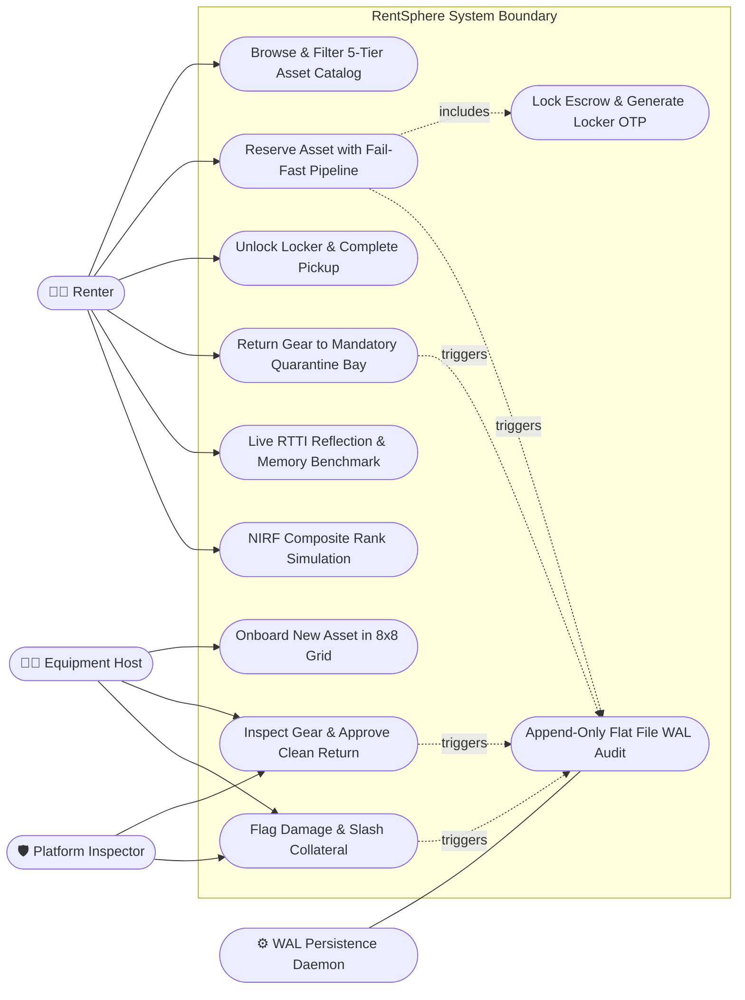
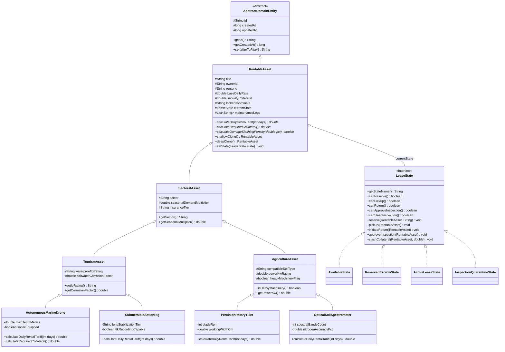
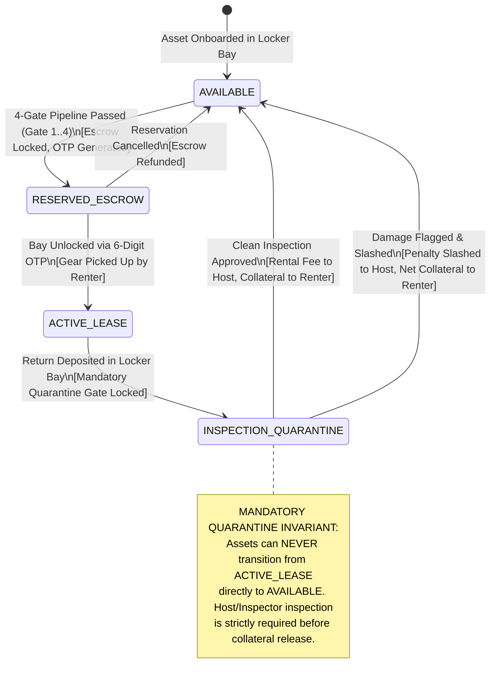
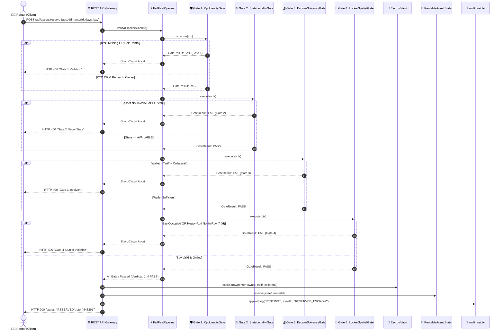

# RentSphere Formal UML Architecture Specifications
**Project**: RentSphere: Decentralized P2P Asset Rental & 8x8 Micro-Storage Engine  
**Institution**: Goa University — Department of Computer Science & Technology  
**Program**: Master of Computer Applications (MCA) — Object-Oriented Technology Lab (Assignment 3)  
**Author**: Nikhil Bhaiju & Mohammed Faaris Khan  
**Diagram Format**: Mermaid.js (Standard Markdown Embedded)

---

## 1. Use Case Diagram
Models platform actors (Renter, Equipment Host, Platform Inspector, WAL Engine) and their system interactions.



---

## 2. 5-Tier Object-Oriented Class Hierarchy Diagram
Models the complete 5-tier inheritance architecture, GoF state composition, and escrow/locker associations.



---

## 3. GoF 4-Stage Statechart Diagram (Mandatory Quarantine Invariant)
Models state transitions, showing that returning active gear **must always** transition to `INSPECTION_QUARANTINE` first. Returning directly to `AVAILABLE` is strictly forbidden.



---

## 4. 4-Gate Fail-Fast Verification Pipeline Sequence Diagram
Demonstrates the short-circuiting sequential execution across `KycIdentityGate`, `StateLegalityGate`, `EscrowSolvencyGate`, and `LockerSpatialGate`.



---

## 5. 8x8 Smart Locker Bay Allocation Activity Diagram
Models physical bay sizing, coordinate computation, and Row 7 Heavy-Agri rule enforcement.

```mermaid
flowchart TD
    Start([Start: Asset Allocation Request]) --> SizingCheck{Determine Equipment Category}
    
    SizingCheck -->|Tourism Small: Cameras & Spectrometers| SizeS[Target Tier: SMALL Rows A-C]
    SizingCheck -->|Tourism Medium: Drones & Accessories| SizeM[Target Tier: MEDIUM Rows D-E]
    SizingCheck -->|Heavy Tourism / Marine Rigs| SizeL[Target Tier: LARGE Rows F-G]
    SizingCheck -->|Heavy Agricultural Machinery| SizeXL[Target Tier: XL_HEAVY_AGRI Row H]

    SizeS --> CheckCoord{Verify Target Bay [r, c]}
    SizeM --> CheckCoord
    SizeL --> CheckCoord
    SizeXL --> CheckCoord

    CheckCoord --> HeavyCheck{Is Asset Heavy Agri?}
    HeavyCheck -->|Yes| RowCheck{Is Row == 7 (Row H)?}
    HeavyCheck -->|No| OccupiedCheck{Is Target Bay Occupied?}

    RowCheck -->|No (Row A-G)| RejectHeavy[Abort: Gate 4 Heavy-Agri Spatial Violation]
    RowCheck -->|Yes (Row H)| OccupiedCheck

    OccupiedCheck -->|Yes| RejectOccupied[Abort: Bay Already In Use]
    OccupiedCheck -->|No| AssignBay[Assign Asset to Bay [r, c]]

    AssignBay --> GenerateOTP[Generate 6-Digit Random Unlock OTP]
    GenerateOTP --> SetTelemetry[Initialize Sensors: 24.5C, 58% Hum, Weight Kg]
    SetTelemetry --> CommitFile[Flush Bay State to data/locker_grid_8x8.txt]
    CommitFile --> End([Allocation Complete])

    RejectHeavy --> EndFail([Allocation Terminated])
    RejectOccupied --> EndFail
```
